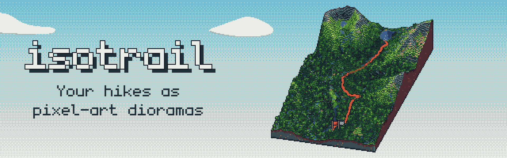
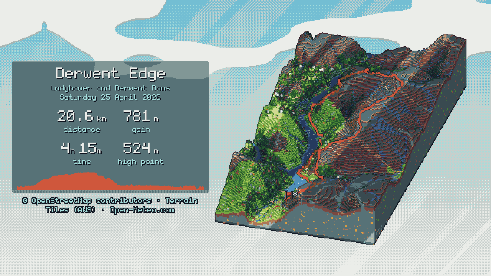
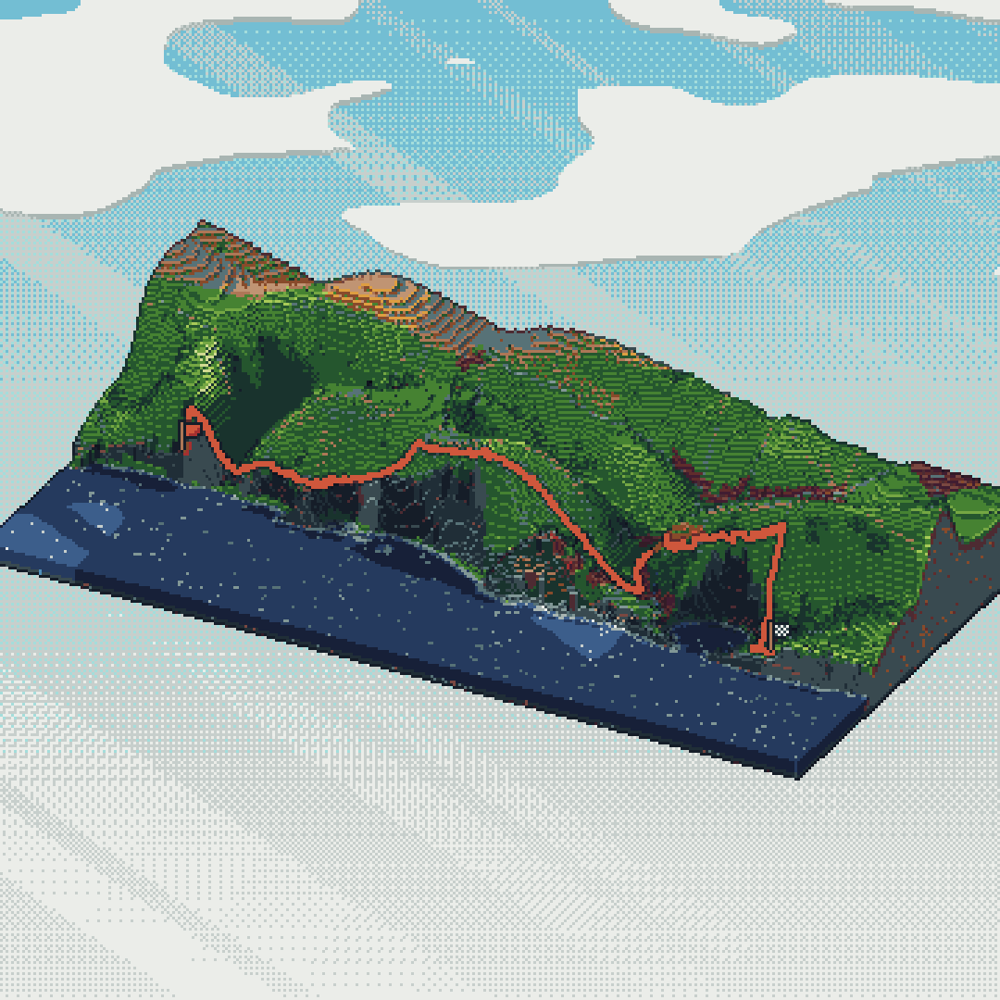
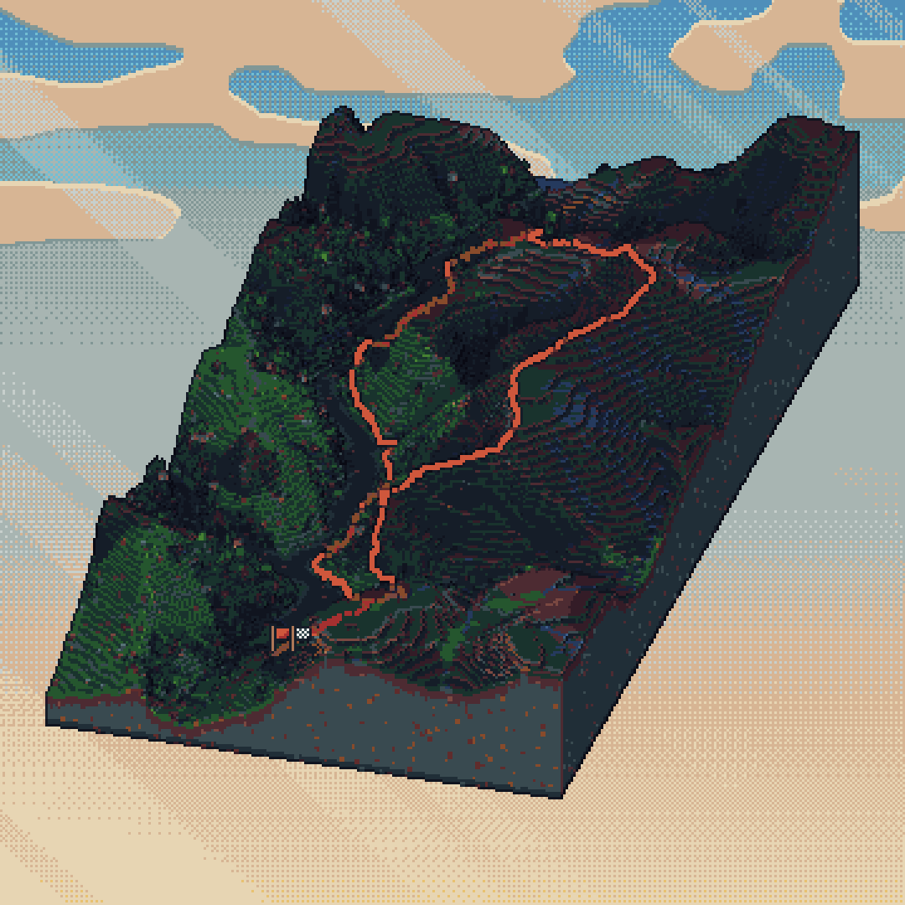
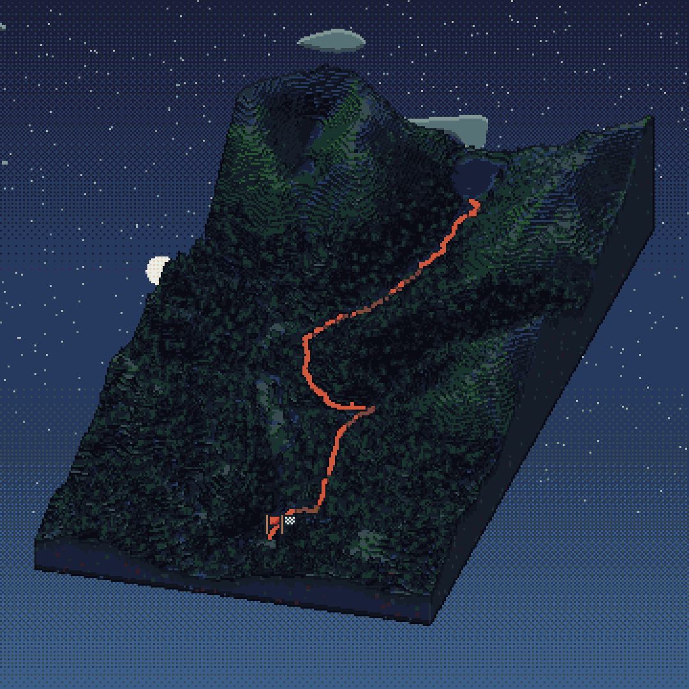
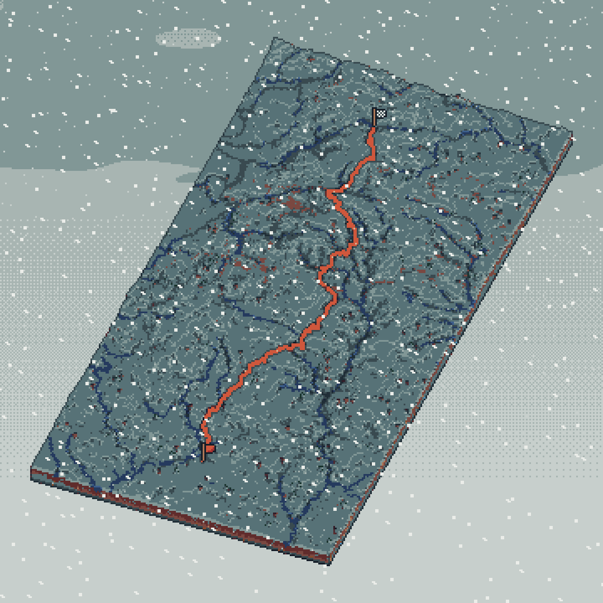
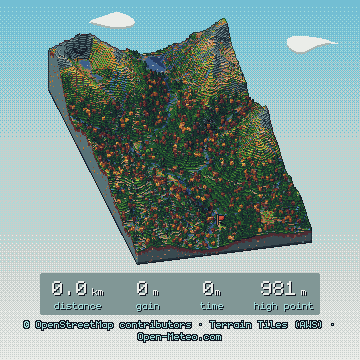
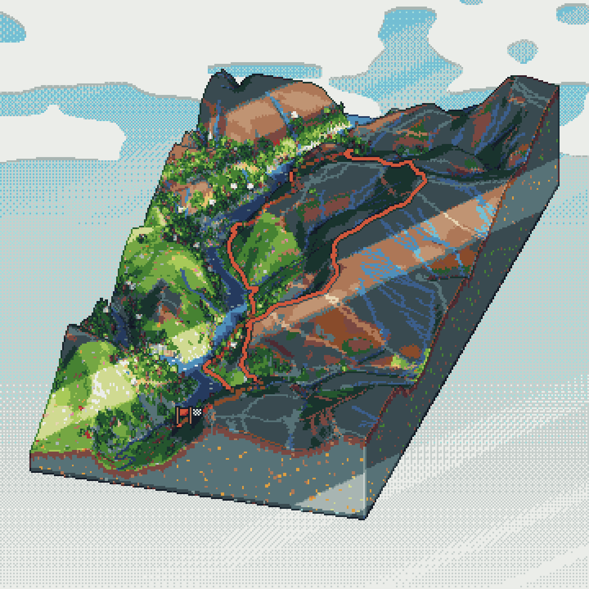
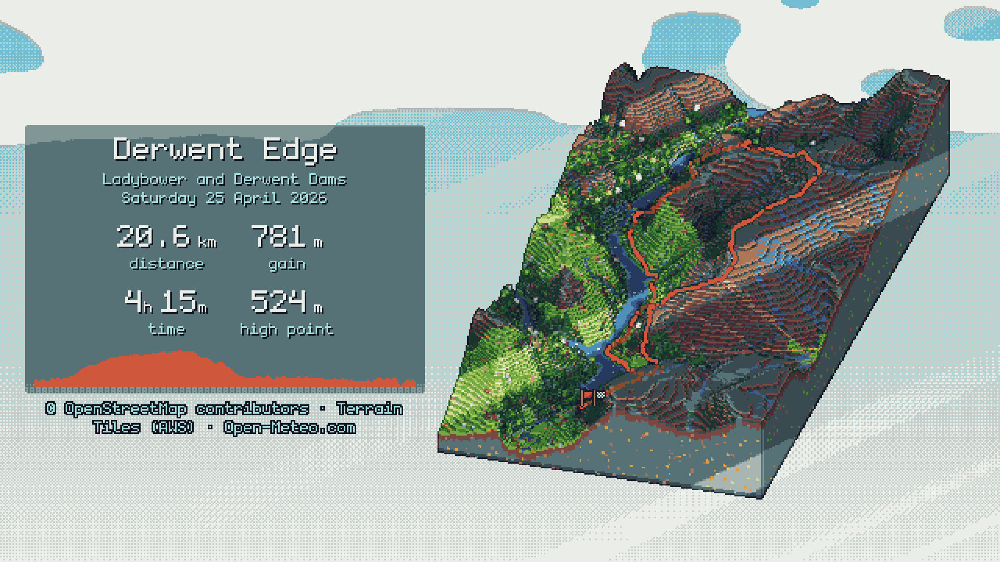
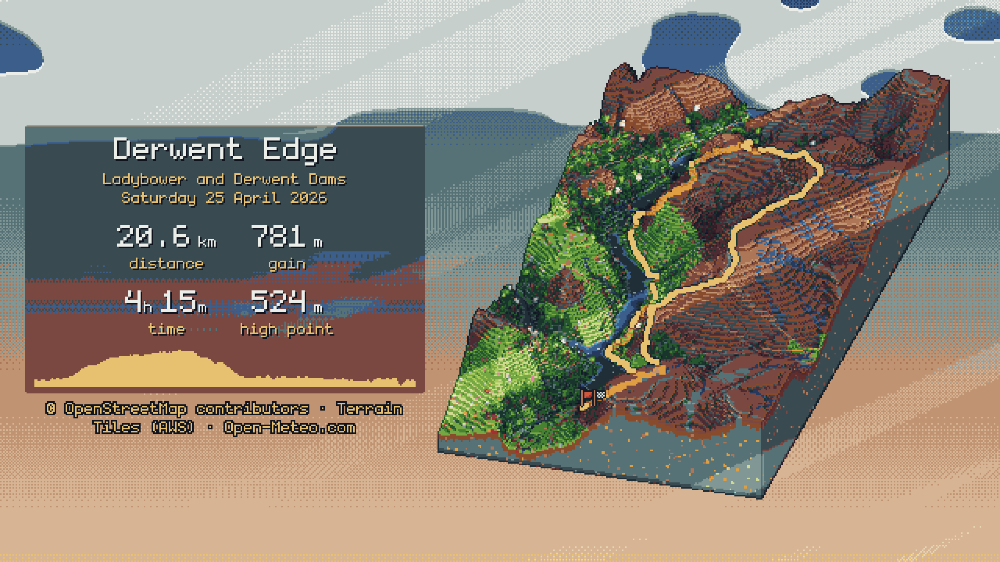

<p align="center">
  
</p>

<p align="center">
  <a href="https://github.com/ErykMajoch/isotrail/actions/workflows/ci.yml"></a>
  <a href="https://github.com/ErykMajoch/isotrail/releases/latest"></a>
  <a href="LICENSE"></a>
</p>

<p align="center">
  <a href="#installation">Installation</a> ·
  <a href="#quick-start">Quick start</a> ·
  <a href="docs/usage.md">Usage</a> ·
  <a href="docs/configuration.md">Configuration</a> ·
  <a href="docs/how-it-works.md">How it works</a>
</p>

---

isotrail turns a recorded hike into a small pixel-art model of the real landscape, with your route drawn on it.

<p align="center">
  
</p>

## Features

- The actual terrain around your route, with its woods, lakes and paths
- The light, weather and season of the day you walked
- A still image, an animation or a diorama visitors can turn on your website
- Presets for stories, posts and short videos, or any size you like
- A scene file that renders the hike again without the network
- Fully customisable to your liking!

## Gallery

<table>
  <tr>
    <td width="33%"></td>
    <td width="33%"></td>
    <td width="33%"></td>
  </tr>
  <tr>
    <td align="center">The sea and passing cloud<br><code>--heading 340 --weather cloudy</code></td>
    <td align="center">A spring evening<br><code>--time 19:30 --weather cloudy</code></td>
    <td align="center">Stars and the moon<br><code>--time 21:45</code></td>
  </tr>
  <tr>
    <td width="33%"></td>
    <td width="33%"></td>
    <td width="33%"></td>
  </tr>
  <tr>
    <td align="center">A long trek in winter<br><code>--season winter --weather snow</code><br><code>--pitch 45</code></td>
    <td align="center">An animation in autumn<br><code>-o hike.gif --season autumn</code></td>
    <td align="center">Smooth terrain<br><code>--mesher smooth</code></td>
  </tr>
</table>

More looks are shown in [how it works](docs/how-it-works.md#styles).

## Installation

Every [release](https://github.com/ErykMajoch/isotrail/releases/latest) has ready-made downloads for Windows, Linux and macOS. Download the archive for your system, unpack it and put `isotrail` in a folder on your `PATH`. Keep the `web` folder next to it, because [`embed`](docs/usage.md#embed) copies the web runtime from there.

The programs aren't signed, so your system may warn you the first time you run one:

- **Windows**: if SmartScreen says it protected your PC, choose More info, then Run anyway.
- **macOS**: Gatekeeper blocks programs downloaded from the internet. Remove the download flag with `xattr -d com.apple.quarantine path/to/isotrail`.
- **Linux**: the program needs glibc 2.35 or newer (Ubuntu 22.04, Debian 12, Fedora 36 or later). On older systems, install it with Cargo.

If you have [Rust](https://rustup.rs/) installed, you can build it with Cargo instead:

```bash
cargo install --git https://github.com/ErykMajoch/isotrail isotrail-cli
```

isotrail draws on the graphics card through Vulkan, Metal or Direct3D 12. Without one, it draws in software. On Linux, that needs a Vulkan driver such as `mesa-vulkan-drivers`.

MP4 videos need [ffmpeg](https://ffmpeg.org/download.html) on your `PATH`. Install it with `winget install Gyan.FFmpeg`, `brew install ffmpeg` or `sudo apt install ffmpeg`. PNG and GIF files don't need it.

## Quick start

Export your hike as a GPX file and run:

```bash
isotrail render hike.gpx
```

This writes `hike.png`, a 1080 x 1920 story. The first run downloads elevation and map data for the area, so it takes longer. Later runs use the cache.

Share it:

```bash
# A story, a feed post and a website banner
isotrail render hike.gpx --aspect story,feed,wide

# A video where the route draws itself and the stats count up
isotrail render hike.gpx -o hike.mp4

# The diorama alone on a transparent background, to place over a photo
isotrail render hike.gpx --background transparent --overlay none
```

Change the look:

```bash
# Your own title and stats, in miles and feet
isotrail render hike.gpx --title "Derwent Edge" --stats distance,gain,elapsed --units imperial

# The same hike in winter
isotrail render hike.gpx --season winter

# Another palette and smooth terrain
isotrail render hike.gpx --palette aap-64 --mesher smooth
```

Put it on a website:

```bash
# A diorama visitors can turn: the scene file, a poster and the HTML to paste
isotrail embed hike.gpx -o site/hikes/my-hike --with-runtime

# The same in another look, for the poster and the live diorama
isotrail embed hike.gpx -o site/hikes/my-hike --palette resurrect-64 --mesher smooth

# A small GIF that loops without a jump
isotrail render hike.gpx -o hike.gif --gif-scale 1 --loop-back
```

The [usage guide](docs/usage.md) goes over a lot more options to play around with.

### Which format for where

| Where | Output |
| --- | --- |
| A story | `--aspect story -o hike.mp4`, or a PNG |
| A short video | `--aspect video -o hike.mp4` |
| A post | `--aspect feed` or `--aspect portrait` |
| Your website | [`isotrail embed`](docs/usage.md#embed), or `--aspect wide` as a PNG |
| Chats, forums, READMEs | `.gif` |

A scene file for the web is ~100KB and every hike on a site shares one runtime of ~1.1MB. A 10-second GIF story is several MB, often over 10MB. `--gif-scale 1` makes it about a quarter of that, and a shorter `--duration` or a lower `--fps` helps too.

## Commands

| Command | What it does |
| --- | --- |
| [`render`](docs/usage.md#render) | Makes a PNG, GIF or MP4 of a hike |
| [`bundle`](docs/usage.md#bundle) | Downloads the terrain and saves the scene as an `.itb` file |
| [`embed`](docs/usage.md#embed) | Writes what a web page needs to show a diorama visitors can turn |
| [`stats`](docs/usage.md#stats) | Prints the distance, climb, times and weather of a hike |
| [`style-lab`](docs/usage.md#style-lab) | Renders every terrain style, pixel scale and palette on one sheet |
| [`cache`](docs/usage.md#cache) | Shows or clears the downloaded data |
| [`theme`](docs/usage.md#theme) | Writes the built-in theme, to start your own from |

More information about the commands can be found in the [usage guide](docs/usage.md).

## Configuration

Settings you use every time can go in a config file instead of on the command line:

```toml
[render]
aspect = ["story", "feed"]
palette = "resurrect-64"
units = "imperial"
```

isotrail reads it from here:

| System | Config file |
| --- | --- |
| Windows | `%APPDATA%\isotrail\config.toml` |
| Linux | `~/.config/isotrail/config.toml` |
| macOS | `~/Library/Application Support/isotrail/config.toml` |

`embed`, `bundle` and `style-lab` read the same file, and can have tables of their own. [Configuration](docs/configuration.md) has the details.

A [theme file](docs/configuration.md#theme-files) changes isotrail's own colours and the words on the image, so a story can be in your language.

<table>
  <tr>
    <td width="50%"></td>
    <td width="50%"></td>
  </tr>
  <tr>
    <td align="center">built-in</td>
    <td align="center"><code>--theme <a href="docs/themes/moorland-dusk.toml">docs/themes/moorland-dusk.toml</a></code></td>
  </tr>
</table>

## Contributing

Bug reports, ideas and pull requests are welcome. [CONTRIBUTING.md](CONTRIBUTING.md) explains how to build, test and update the reference images.

## Credits

- Map data © [OpenStreetMap contributors](https://www.openstreetmap.org/copyright), under the [ODbL](https://opendatacommons.org/licenses/odbl/), through the [Overpass API](https://overpass-api.de/)
- Elevation from [Terrain Tiles](https://registry.opendata.aws/terrain-tiles/) on AWS Open Data, built by [Tilezen joerd](https://github.com/tilezen/joerd) from [these sources](https://github.com/tilezen/joerd/blob/master/docs/attribution.md)
- Weather by [Open-Meteo.com](https://open-meteo.com/), under [CC BY 4.0](https://creativecommons.org/licenses/by/4.0/)
- Time zones from [tzf-rs](https://github.com/ringsaturn/tzf-rs), with [timezone-boundary-builder](https://github.com/evansiroky/timezone-boundary-builder) data © OpenStreetMap contributors (ODbL)
- Palettes by AdamCYounis, Kerrie Lake and Adigun A. Polack, listed in [assets/README.md](assets/README.md)
- The [monogram](https://datagoblin.itch.io/monogram) font by Vinícius Menézio (CC0)

Every image and web embed carries a small data credit. If you turn it off (with `--no-attribution` or with `credit="none"` on the embed) please put the printed credit in your caption or near the embed instead.

The elevation, map and weather services are free and shared by everyone. [Data sources and fair use](docs/how-it-works.md#data-sources-and-fair-use) explains what isotrail downloads and how the cache keeps that small. Open-Meteo's free weather service is for non-commercial use. For commercial work, set `ISOTRAIL_OPEN_METEO_KEY` to a paid Open-Meteo key, or leave the weather out with `--no-weather`.

## Licence

isotrail is released under the [MIT licence](LICENSE).
