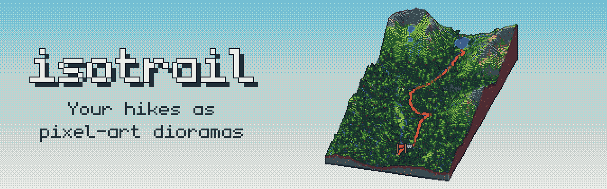
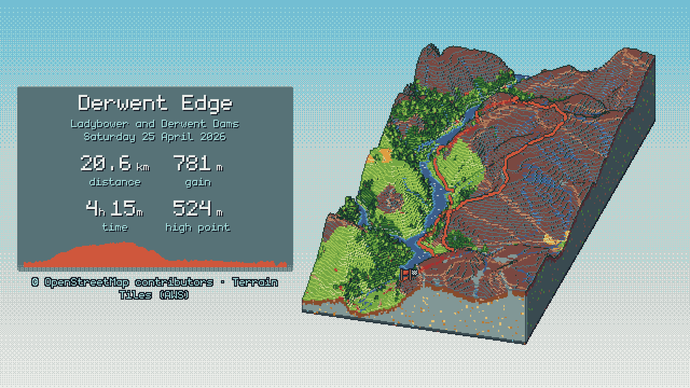
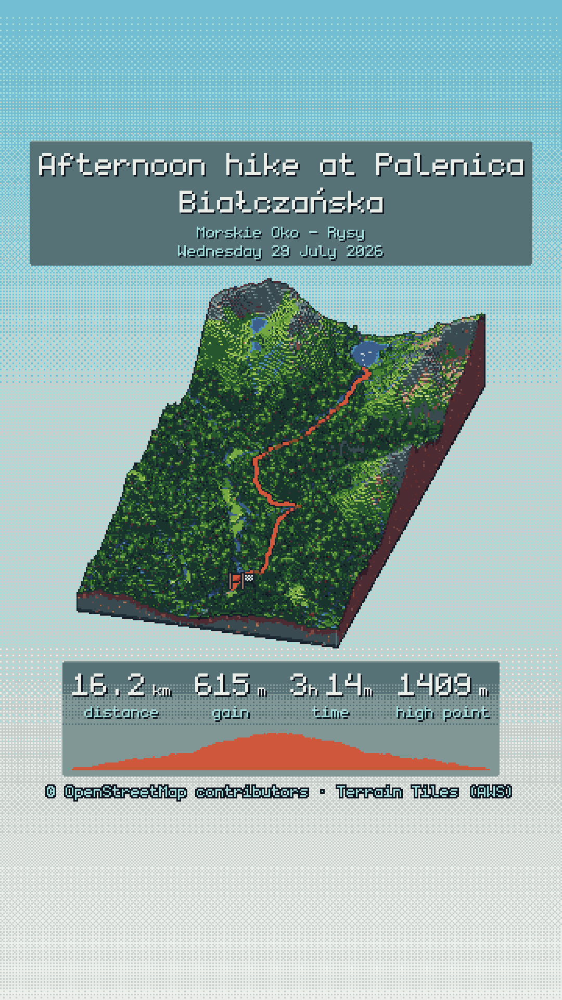
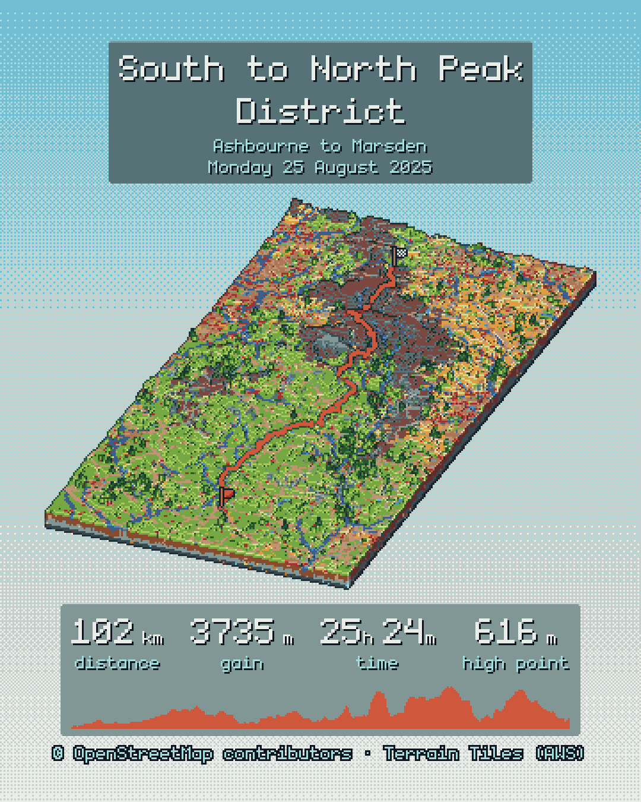
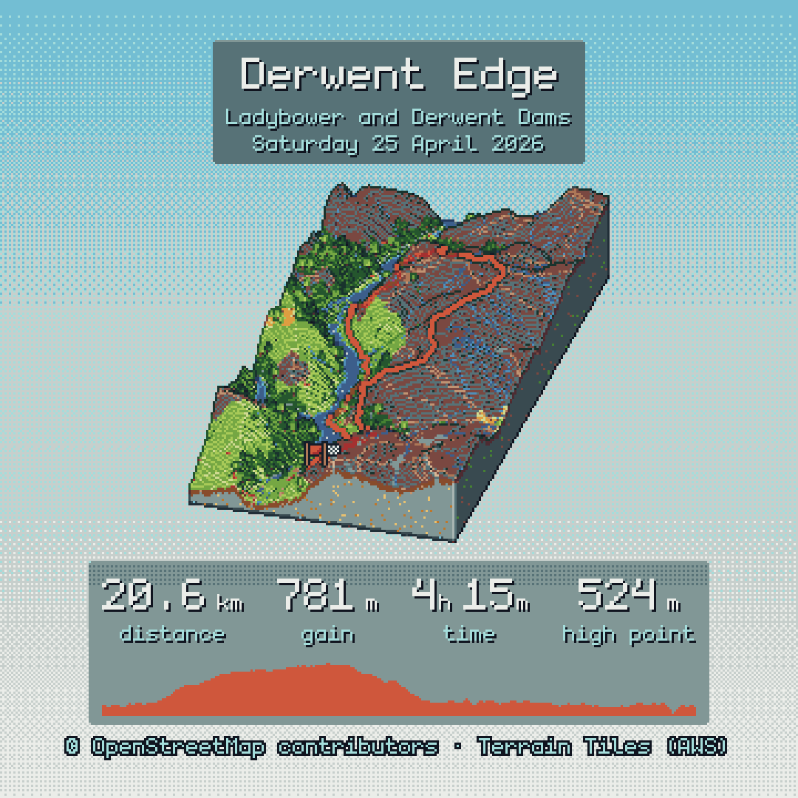

<p align="center">
  
</p>

<!-- <p align="center">
  <strong>Turn a recorded hike into a pixel-art diorama of the real terrain.</strong>
</p> -->

<p align="center">
  <a href="https://github.com/ErykMajoch/isotrail/actions/workflows/ci.yml"></a>
  <a href="https://github.com/ErykMajoch/isotrail/releases/latest"></a>
  <a href="LICENSE"></a>
</p>

<p align="center">
  <a href="#installation">Installation</a> ·
  <a href="#quick-start">Quick start</a> ·
  <a href="docs/usage.md">Usage</a> ·
  <a href="docs/configuration.md">Configuration</a> ·
  <a href="docs/how-it-works.md">How it works</a>
</p>

---

`isotrail` takes a GPX file any route tracking app and cuts the surrounding landscape out of the world as a floating slab.

<p align="center">
  
</p>

## Features

- **Real terrain**: elevation from open terrain tiles, with forests, moorland, rock, lakes, rivers and paths from OpenStreetMap
- **Diorama look**: stepped voxel or smooth low-poly terrain, layered cut faces, cel shading with shadows, and outlines
- **Pixel-art finish**: every pixel snapped to a hand-made palette (three built in, or any Lospec `.hex` file)
- **Ready to share**: story, feed, square and wide presets, with the title, date, stats and elevation profile laid out around Instagram's interface
- **Your style**: choose the stats, units, date format and panels, or use a transparent background to place the diorama over a photo
- **Offline and repeatable**: map data is cached, and a scene bundle (`.itb`) re-renders a hike without the network
<!-- 
## Gallery

<table>
  <tr>
    <td width="33%"></td>
    <td width="33%"></td>
    <td width="33%"></td>
  </tr>
  <tr>
    <td align="center"><code>--aspect story</code></td>
    <td align="center"><code>--aspect feed</code></td>
    <td align="center"><code>--aspect square</code></td>
  </tr>
</table>

More looks are shown in [How it works](docs/how-it-works.md#styles). -->

## Installation

**Prebuilt binaries** for Windows, Linux and macOS are attached to every [release](https://github.com/ErykMajoch/isotrail/releases/latest). Download the archive for your system, unpack it and put `isotrail` (`isotrail.exe` on Windows) somewhere on your `PATH`.

**With Cargo**, if you have [Rust](https://rustup.rs/) installed:

```bash
cargo install --git https://github.com/ErykMajoch/isotrail isotrail-cli
```

`isotrail` renders on the GPU through Vulkan, Metal or Direct3D 12. When no GPU is available, it falls back to a software renderer. On Linux, this needs a Vulkan driver, such as `mesa-vulkan-drivers`.

## Quick start

Export your hike as a GPX file and run:

```bash
isotrail render hike.gpx
```

This writes `hike.png`, a 1080 x 1920 story. The first run downloads elevation and map data for the area, and later runs use the cache.

```bash
# A story, a feed post and a website banner in one go
isotrail render hike.gpx --aspect story,feed,wide

# The diorama alone on a transparent background, to place over a photo
isotrail render hike.gpx --background transparent --overlay none

# Your own title and stats, in miles and feet
isotrail render hike.gpx --title "Derwent Edge" --stats distance,gain,elapsed --units imperial

# Prepare the scene once, then render it as often as you like, offline
isotrail bundle hike.gpx -o hike.itb
isotrail render hike.itb --palette aap-64 --mesher smooth
```

## Commands

| Command | What it does |
| --- | --- |
| [`render`](docs/usage.md#render) | Render a GPX file or scene bundle as a PNG |
| [`bundle`](docs/usage.md#bundle) | Download the terrain around a route and save everything the render needs as a `.itb` file |
| [`stats`](docs/usage.md#stats) | Print distance, elevation gain and loss, moving and elapsed time |
| [`style-lab`](docs/usage.md#style-lab) | Render every mesher, pixel scale and palette on one contact sheet |
| [`cache`](docs/usage.md#cache) | Show or clear the cache of downloaded data |

Run `isotrail <command> --help` for every option, or see the [usage guide](docs/usage.md).

## Configuration

Settings you use every time can go in a config file instead of on the command line:

```toml
# %APPDATA%\isotrail\config.toml on Windows, ~/.config/isotrail/config.toml on Linux
[render]
aspect = ["story", "feed"]
palette = "resurrect-64"
units = "imperial"
```

See [Configuration](docs/configuration.md) for file locations, precedence and environment variables.

## Roadmap

- Animated GIF and MP4
- An `<isotrail-hike>` web component to embed interactive dioramas on a static site
- Lighting from the real time of day of the hike
- Historical weather and a seasonal look

## Contributing

Bug reports, ideas and pull requests are welcome. See [CONTRIBUTING.md](CONTRIBUTING.md) for how to build, test and update the reference images.

## Credits

- Map data © [OpenStreetMap contributors](https://www.openstreetmap.org/copyright), available under the [ODbL](https://opendatacommons.org/licenses/odbl/), fetched through the [Overpass API](https://overpass-api.de/)
- Elevation data from [Terrain Tiles](https://registry.opendata.aws/terrain-tiles/) on AWS Open Data, assembled by [Tilezen joerd](https://github.com/tilezen/joerd) from sources including SRTM, GMTED2010 and 3DEP (courtesy of the U.S. Geological Survey), ETOPO1 (NOAA), EU-DEM (produced using Copernicus data and information funded by the European Union) and national datasets such as © Environment Agency copyright and/or database right 2015 (see the [full attribution list](https://github.com/tilezen/joerd/blob/master/docs/attribution.md))
- Time zones from [tzf-rs](https://github.com/ringsaturn/tzf-rs), using [timezone-boundary-builder](https://github.com/evansiroky/timezone-boundary-builder) data © OpenStreetMap contributors (ODbL)
- Palettes by AdamCYounis, Kerrie Lake and Adigun A. Polack, and the [monogram](https://datagoblin.itch.io/monogram) font by Vinícius Menézio (CC0); see [assets/README.md](assets/README.md)

Every render carries a small data credit by default. If you leave it off with `--no-attribution`, please put the printed credit in your post's caption instead.

## Licence

`isotrail` is released under the [MIT licence](LICENSE).
