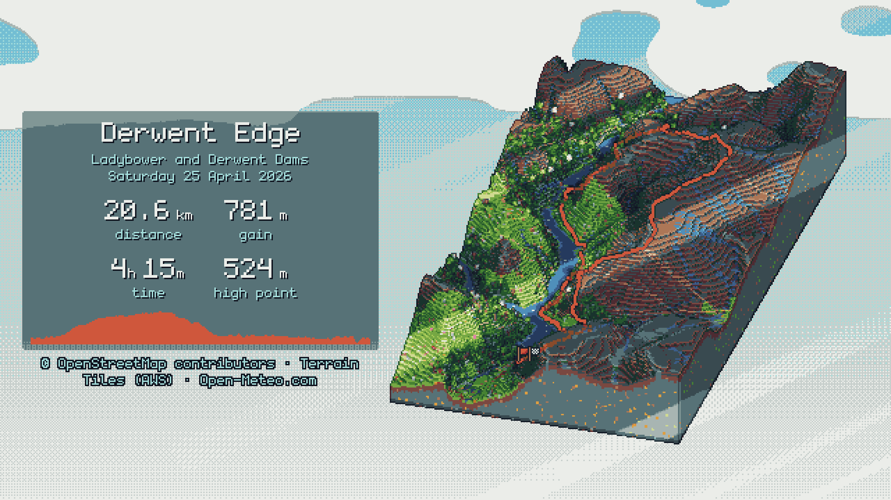
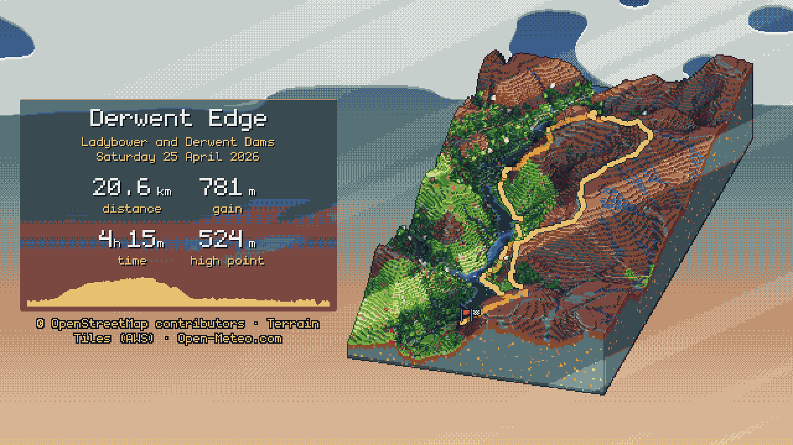

# Configuration

## Config files

Settings you use every time can go in a TOML file instead of on the command line. Settings for `render` go in a `[render]` table, named after its long [options](usage.md#render) without the leading dashes:

```toml
[render]
aspect = ["story", "square"]
scale = 3
palette = "resurrect-64"
units = "imperial"
date-format = "short"
stats = ["distance", "gain", "elapsed"]
no-attribution = true
background = "#1e2a33"
season = "autumn"
god-rays = "on"
pitch = 40
safe-area = [14, 6, 35, 6]     # top, right, bottom, left
strata = "off"
weather-effects = ["clouds", "haze"]
route-colour = "#2a6fdb"
sun = [250, 8]                 # azimuth, elevation
credit-extra = "photos and walks: example.org"
orbit = 0
hold = "3s"
loop = "once"                  # or "forever", or a number of plays
gif-scale = 1
crf = 23
cache-dir = "D:/isotrail-cache"
```

- An option that takes a list separated by commas takes a TOML list.
- Numbers stay numbers. Switches such as `no-attribution` are `true` or `false`.
- Options that take `on` or `off`, such as `strata`, take `true` or `false` too.
- Animation settings such as `orbit` only apply to `.gif` and `.mp4` output, so PNG renders ignore them.
- `route-color` works as a key too, the same as `route-colour`.

A `size` typed on the command line replaces the `aspect` from a file, because the two can't be combined. The same goes for two files: a `size` in the `--config` file replaces an `aspect` in your user file. One table can't hold both.

The `cache-dir` in the `[render]` table of your user config file is also where `isotrail cache path` and `cache clear` look, so they name and empty the folder your renders use.

### The other commands

`embed`, `bundle` and `style-lab` read the same files. Each takes the `[render]` settings that are also its own options and ignores the rest. One file then gives your web embeds and renders the same look.

| Command | Takes from `[render]` |
| --- | --- |
| `embed` | Every setting that is also an `embed` option |
| `bundle` | `title`, `exaggeration` and the data settings |
| `style-lab` | `exaggeration`, `theme` and the data settings only |

For `embed`, that means the look, theme, scene, camera, text and data settings. It also takes `scale`, `size` and `safe-area` for the poster, and `aspect` when it names one shape. The playback settings `duration`, `intro`, `hold`, `loop-back`, `orbit`, `pace` and `loop` reach it too.

The data settings include `padding`, `footprint` and the server and cache settings. `style-lab` takes no palette or scale from `[render]`, so the ones you render with don't narrow its comparison.

A command's own table, `[embed]`, `[bundle]` or `[style-lab]`, holds its own options and wins over `[render]` for that command:

```toml
[render]
palette = "resurrect-64"       # renders and embeds
aspect = ["story", "feed"]     # renders only: an embed has one shape

[embed]
aspect = "wide"
base-url = "/hikes/"
with-runtime = true
loop = "forever"               # the embed's own: GIFs keep the [render] setting
controls = ["play", "scrubber"]

[style-lab]
palette = ["apollo", "resurrect-64", "warm.hex"]
scale = [3, 5]
```

isotrail reads two files, if they exist:

1. **Your user config file**, used for every command:

   | System | Location |
   | --- | --- |
   | Windows | `%APPDATA%\isotrail\config.toml` |
   | Linux | `~/.config/isotrail/config.toml` (or `$XDG_CONFIG_HOME/isotrail/config.toml`) |
   | macOS | `~/Library/Application Support/isotrail/config.toml` |

   Set `ISOTRAIL_CONFIG` to use a different file, or set it to an empty value to ignore the user file. A file named by `ISOTRAIL_CONFIG` must exist.

2. **A file given with `--config`**, for one run. Use it to keep one file per project or per hike.

### Precedence

From highest to lowest:

1. Options on the command line, and environment variables such as `ISOTRAIL_OVERPASS_URL` or `ISOTRAIL_CACHE_DIR`
2. The `--config` file
3. The user config file
4. Built-in defaults

Within one file, the command's own table wins over `[render]`. A switch set to `true` in the user file can be turned off again with `false` in the `--config` file.

An option you type also wins over settings it can't be combined with. With `date-format = "short"` in a file, `--date "June 2025"` on the command line prints that text, and the setting is left out.

### Rules

- Only the `[render]`, `[embed]`, `[bundle]` and `[style-lab]` tables are allowed, so typos don't go unnoticed.
- Each table only takes its command's options. An unknown key is an error, and so are `output`, `config`, `debug-dir`, `verbose`, `quiet`, `json`, `help` and `version`, which only make sense for one run.
- A bad value is reported with the name of the file it came from, for example `scale in hike.toml: expected a whole number from 1 to 16`.
- `--background` in a config file keeps its exact colour, as it does on the command line.
- `time` can be a string (`"07:30"`) or a TOML time (`07:30:00`).
- Options that take `on` or `off`, such as `paths` or `shadows`, take `true` or `false` too.
- Mistakes in a config file stop the command with exit code 2, like mistakes on the command line.

## Theme files

A theme file changes isotrail's own colours, words and fine-tuning. It covers the ground and its layers, trees, water, the seasons, the sky and the light, the route, and the text and panels. It also holds every word printed on an image, so a story can be labelled in your language. It is a TOML file, passed with `--theme FILE` to `render`, `embed` or `style-lab`, or named in a config file:

```toml
[render]
theme = "themes/autumn.toml"   # relative to the folder you run isotrail in
```

Start from the built-in theme, which lists every key with its built-in value:

```sh
isotrail theme print -o my-theme.toml
```

Keep the keys you change and delete the rest: a key that isn't there keeps its built-in value. A small theme might be:

```toml
[landcover]
grassland = "#8fbf5a"
heath = "#7a5c6e"

[route]
colour = "#ffcc00"
width = 3

[overlay]
panel-tint = "#2b1d3a"
subtext = "#f2c879"

[light]
ambient = 0.5
```

A fuller example is [`docs/themes/moorland-dusk.toml`](themes/moorland-dusk.toml), here next to the built-in look:

<table>
  <tr>
    <td width="50%"></td>
    <td width="50%"></td>
  </tr>
  <tr>
    <td align="center">built-in</td>
    <td align="center"><code>--theme docs/themes/moorland-dusk.toml</code></td>
  </tr>
</table>

| Table | What it holds |
| --- | --- |
| `[landcover]` | One colour per kind of ground, such as `grassland` or `heath` |
| `[terrain]` | `side-shade`: how bright the walls of steps and slopes are, as a share of the ground on top |
| `[strata]` | The layers on the slab's cut faces, the water at its edges, and pebbles and ore |
| `[props]` | Trees, bushes and boulders, and how far apart they stand |
| `[water]` | Lake shores, the sea and its surf, glints and ice |
| `[paths]` | Paths and roads from the map, and how strongly they show |
| `[season]` | Snow, spring leaves and blossom, autumn leaves, meadow flowers, crops, bracken and winter grass |
| `[sky]` | The daytime sky at the top and bottom of the image, and its dithering |
| `[light]` | The daylight, ambient light, moonlight, and how many bands the light is cut into |
| `[route]` | The route's colour and width, its dark border, and how the parts behind ridges fade |
| `[overlay]` | The text and panels, the profile, the side column and where long titles split |
| `[labels]` | Every word and format the overlays print |
| `[animation]` | How long nights take in clips of multi-day hikes, and the longest stop that `--pace time` keeps |

`[landcover]` has a key for each kind of ground: `water`, `snow`, `rock`, `scree`, `grassland`, `heath`, `scrub`, `coniferous`, `broadleaf`, `mixed-forest`, `wetland`, `farmland` and `built-up`. `[strata]` sets how many blocks per thousand show a pebble or ore.

`[light]` also holds the ambient light's tint, the fill on faces turned towards you, and the sun for tracks without times. Its four sub-tables hold the light and sky as the sun sinks: `[light.golden]` at 6° up, `[light.sunrise]` at the horizon, `[light.twilight]` at 6° down and `[light.night]` at 18° down. In between, they blend.

`[overlay]` holds the colours of the text, labels and shadows, and the panels' tint, blur and top edge. It also sets the colour of the unwalked part of the profile, the profile's height and the width of the side column in images wider than they are tall.

Colours are `"#rrggbb"`. Like everything drawn, they are moved to the nearest colour of the palette, so pick a palette that has them, or `--palette none`. The light's colours are strengths of red, green and blue, such as `[1.0, 0.96, 0.88]`, where `1.0` is full strength. `"#rrggbb"` works there too.

### Labels in your language

`[labels]` holds the stat labels, the units, and patterns for times and dates, where names in braces are filled in:

```toml
[labels]
distance = "dystans"
gain = "podejścia"
time = "czas"
high-point = "wysokość"
decimal = ","                                   # 7,4 km
hours = "{h} godz. {mm} min"                    # {h}, {m}, or {mm} with two digits
minutes = "{m} min"
date-long = "{weekday}, {day} {month} {year}"   # sobota, 14 czerwca 2025
months = ["stycznia", "lutego", "marca", "kwietnia", "maja", "czerwca", "lipca", "sierpnia", "września", "października", "listopada", "grudnia"]
months-short = ["sty", "lut", "mar", "kwi", "maj", "cze", "lip", "sie", "wrz", "paź", "lis", "gru"]
weekdays = ["poniedziałek", "wtorek", "środa", "czwartek", "piątek", "sobota", "niedziela"]
```

Weekdays start on Monday. Date patterns take `{weekday}`, `{weekday-short}`, `{day}`, `{dd}`, `{month}`, `{month-short}`, `{mm}`, `{year}` and `{yyyy}`, so `months` can hold the form your language uses inside a date. The font draws Latin letters with their accents, including Polish, Czech and the other languages of central Europe. Anything else is left out with a warning.

### How a theme combines with options

Options you type, and settings in a config file, win over the theme. The two that overlap are `--route-colour` and `--route-width`. The theme wins over the built-in values. `--outlines` still scales the edges, and a forced `--weather` still greys the theme's sky.

`embed --theme` draws the poster in the theme and copies the file beside the bundle. The snippet names the copy in a `theme` attribute, so the live diorama is drawn in the same theme. The theme's `[labels]` don't reach the live diorama, which draws no text. The element's own words are set with its `lang` and `strings` attributes (`embed --lang`, `--strings`).

### Rules

- Unknown tables and keys are errors, as are values out of range and lists of the wrong length. The message names the file and the key, for example `the theme autumn.toml: labels.months: expected a list of 12, found 11 items`, and the command stops with exit code 2 before any work.
- The file must be UTF-8. Windows PowerShell 5.1 saves `>` output as UTF-16, so use `isotrail theme print -o FILE` there.
- The font, the start and finish markers, and the data credit can't be changed. The credit must name the data actually used, and `--credit-extra` adds a line of your own under it.

## Environment variables

| Variable | Effect |
| --- | --- |
| `ISOTRAIL_CONFIG` | The user config file to read, or empty for none |
| `ISOTRAIL_CACHE_DIR` | The folder for downloaded data, the same as `--cache-dir` (see [`cache`](usage.md#cache)) |
| `ISOTRAIL_OVERPASS_URL` | The Overpass server for map data, the same as `--overpass-url` |
| `ISOTRAIL_TERRAIN_URL` | The server for elevation tiles, the same as `--terrain-url` |
| `ISOTRAIL_WEATHER_URL` | A server with Open-Meteo's API, the same as `--weather-url` |
| `ISOTRAIL_OPEN_METEO_KEY` | An API key for one of [Open-Meteo's paid plans](https://open-meteo.com/en/pricing) |
| `ISOTRAIL_FFMPEG` | The ffmpeg program for MP4 output, the same as `--ffmpeg` |
| `ISOTRAIL_GPU` | Which GPU to draw with: `auto`, `hardware` or `software` (default `auto`) |

`ISOTRAIL_CONFIG` must name a file that exists. With an Open-Meteo key, the weather comes from Open-Meteo's servers for customers, or from `--weather-url` with the key added. The key can only be set in the environment, never in a config file or on the command line.

`ISOTRAIL_GPU=software` draws with a software renderer: WARP on Windows and lavapipe on Linux. Use it on a server without a GPU.
