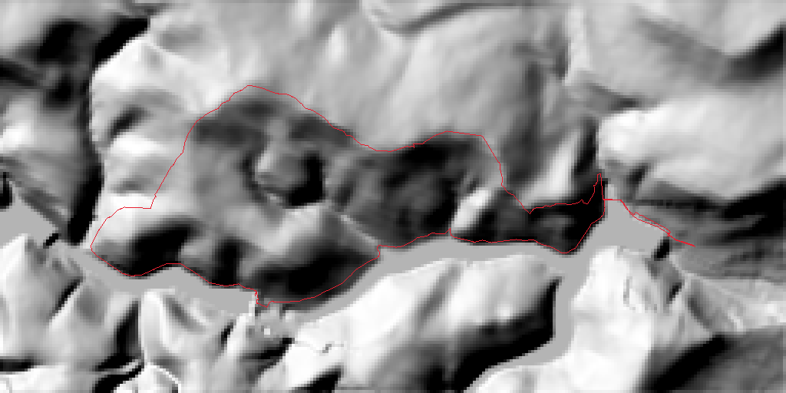
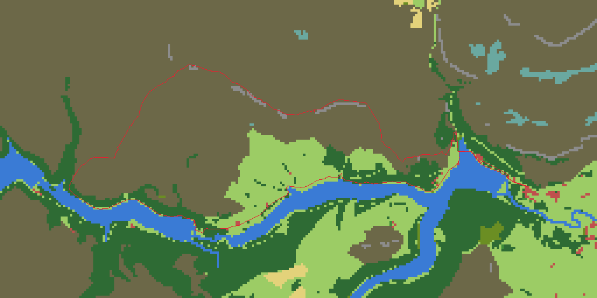
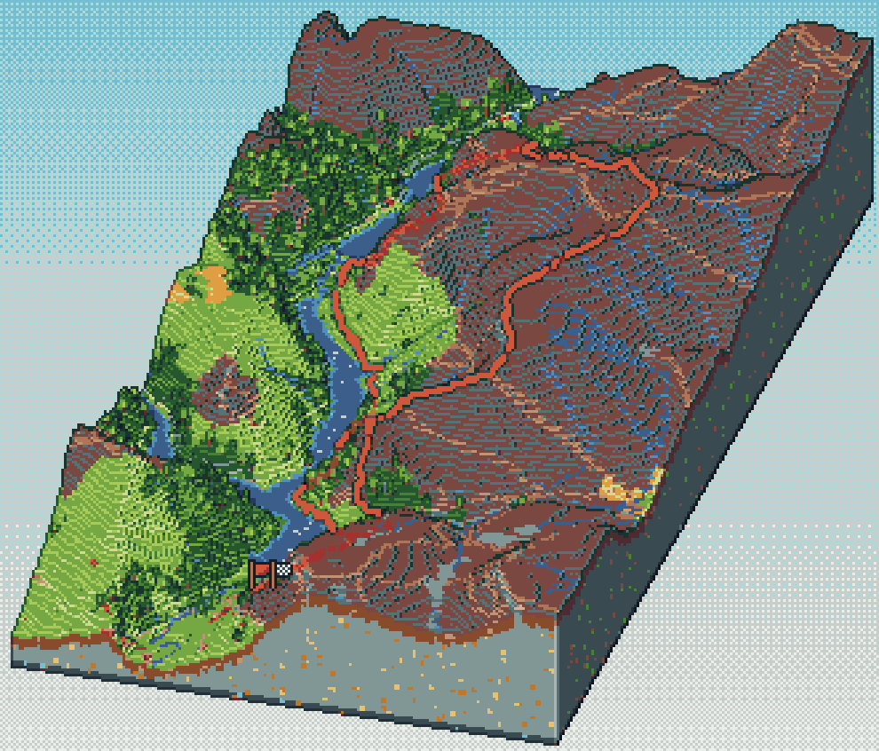
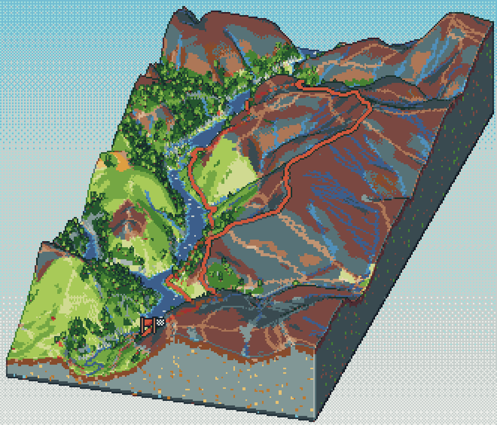
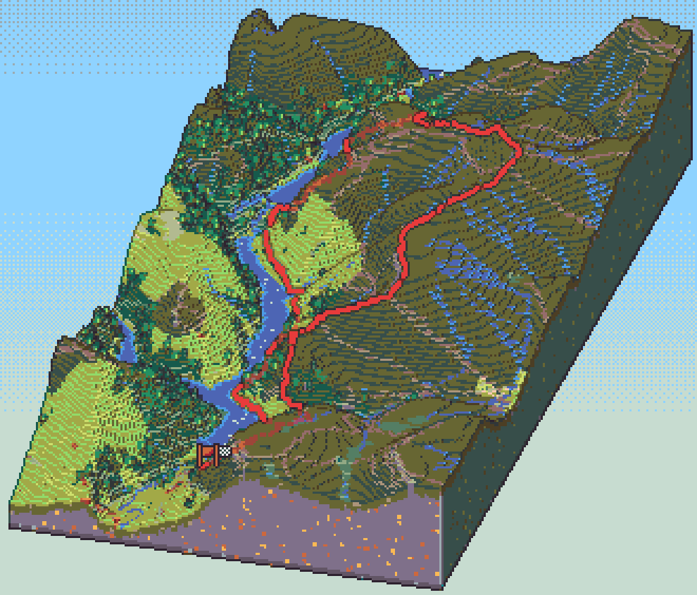
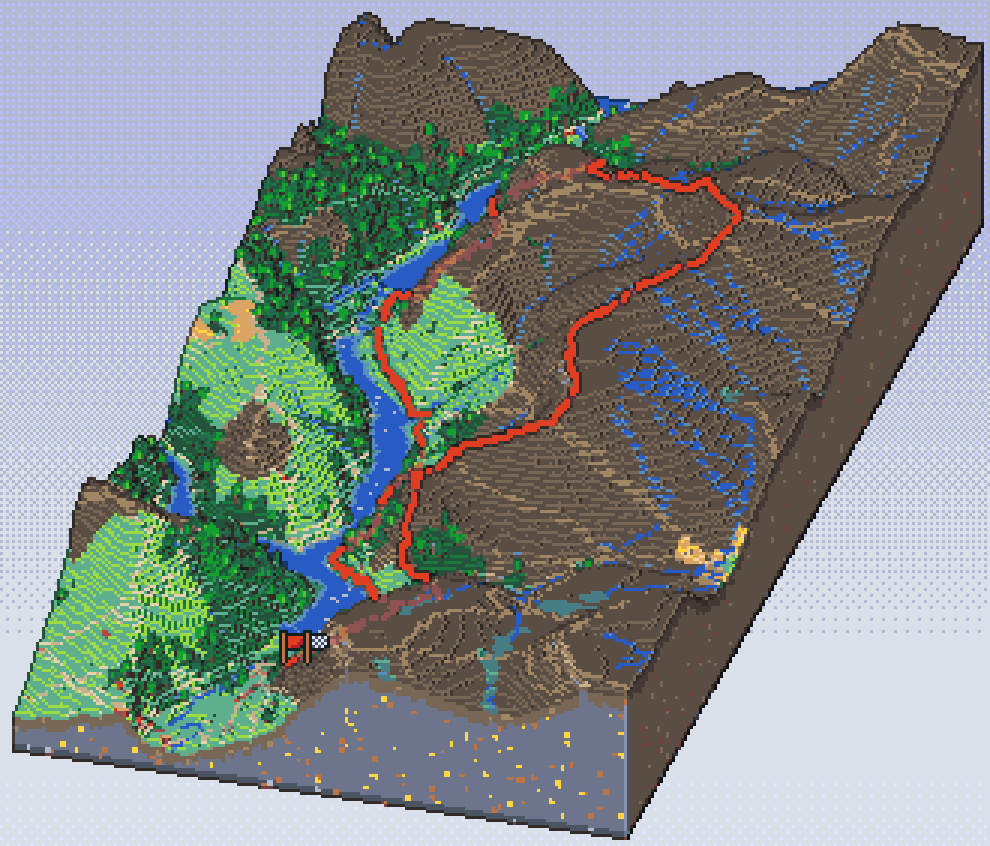

# How it works

`isotrail` turns a hike into an image in two stages. First it **prepares a scene**: it reads the GPX file, downloads the terrain around it and works out what covers the ground. Then it **renders** that scene on the GPU as low-resolution pixel art and enlarges it.

`isotrail render hike.gpx` runs both stages. `isotrail bundle` stops after the first and saves the scene, and `isotrail render hike.itb` starts from a saved scene.

## Preparing the scene

**The track.** isotrail reads every track point and drops segments too short to draw. It computes distance, elevation gain and loss (smoothed, so that GPS noise doesn't inflate the climb), moving and elapsed time, and the local time zone of the start, which is used for the date.

**The slab.** The diorama is a rectangle of terrain around the route, turned to line up with the direction the route mostly runs in, so diagonal routes don't waste space. It is padded by 15% on each side (at least 500 m) and widened so that it is never more than twice as long as it is wide. The slab is divided into a grid of about 256 cells along its long side (`--detail`): about 25 m per cell for a day hike, a few hundred metres for a multi-day trek.

**Elevation.** Heights come from the open [Terrain Tiles](https://registry.opendata.aws/terrain-tiles/) dataset. isotrail picks the zoom level whose resolution matches the grid and samples each cell from it. Heights are then exaggerated so the relief reads at diorama scale: gentle moors get up to 5× and steep mountains less (`--exaggeration` overrides this).

**Landcover.** One [Overpass](https://overpass-api.de/) query fetches OpenStreetMap's forests, moorland, rock, scree, grass, farmland, wetlands, water, paths, roads and streams for the slab. These are drawn onto the grid. Cells that the map leaves empty are classified from the terrain: steep slopes become bare rock, and high ground becomes grass or rock. Lakes and reservoirs are flattened to a single water level.

  
  

The route is then draped onto the terrain, and everything is saved together as a scene bundle: a compact, versioned binary file of about 100 KB.

## Rendering

The scene is drawn with [wgpu](https://wgpu.rs/) at a small internal resolution: 360 × 640 for a story at the default `--scale 3`.

1. **Mesh.** The `voxel` mesher builds one column of blocks per cell, with the height rounded to whole blocks. The `smooth` mesher builds a low-poly surface with one flat colour per triangle. Trees and boulders are placed by a random generator seeded from the scene, so the same hike always renders the same way.
2. **Slab sides.** The cut faces show strata that follow the surface: a darker topsoil, a few blocks of dirt, then stone, with a band of deep stone at the base and seeded pebbles and ore. Where a lake reaches the edge, its water shows in cross-section.
3. **Light.** A late-morning sun from the south-south-east casts shadows from a shadow map. Lighting is cel-shaded into a few flat bands, and a soft fill from the viewer's side keeps faces that point away from the sun readable.
4. **Outlines.** Dark lines mark the slab's silhouette and the places where one surface passes in front of another. Sharp outward folds, such as ridges and the rim of the slab, are picked out in a lighter shade.
5. **Route.** The route is a bold line with a dark border that climbs every block step it crosses. Where a ridge hides it, it shows through as a faint dashed line. Flags mark the start and finish.
6. **Palette.** Every pixel is snapped to the nearest colour of the palette, compared in [OKLab](https://bottosson.github.io/posts/oklab/), a colour space that matches how alike colours look to the eye. The sky gradient is dithered with a fine checker pattern.
7. **Text.** The title, date, stats and elevation profile are drawn in the [monogram](https://datagoblin.itch.io/monogram) pixel font, on frosted panels that blur and tint the scene behind them. The panels are laid out around Instagram's interface.
8. **Enlarge.** The frame is scaled up by a whole number without smoothing, so every drawn pixel becomes a crisp square.

## Animation

An animation renders the same scene once per frame. The mesh, trees and route are built once, and the camera keeps one scale for the whole clip, wide enough to fit the slab from every angle of its turn, so the diorama never grows or shrinks. The camera's position is rounded to whole pixels, so the terrain doesn't shimmer as it moves.

Each frame draws the route up to a point: by distance, or by the recorded time with long stops cut short (`--pace time`). The same point fills the profile and sets the stats, which count up from what the hike had covered so far. The finished frames are written to the GIF one by one, each keeping only the area that changed since the frame before. Frames that look the same as the one before are merged into one longer frame. For an MP4, each frame is enlarged to the full output size and piped to ffmpeg, which encodes it as H.264.

## Styles

The meshers and palettes can be mixed freely. `isotrail style-lab` renders every combination for your hike on one contact sheet.

<table>
  <tr>
    <td width="25%"></td>
    <td width="25%"></td>
    <td width="25%"></td>
    <td width="25%"></td>
  </tr>
  <tr>
    <td align="center"><code>voxel</code> · <code>apollo</code> (default)</td>
    <td align="center"><code>smooth</code> · <code>apollo</code></td>
    <td align="center"><code>voxel</code> · <code>resurrect-64</code></td>
    <td align="center"><code>voxel</code> · <code>aap-64</code></td>
  </tr>
</table>
