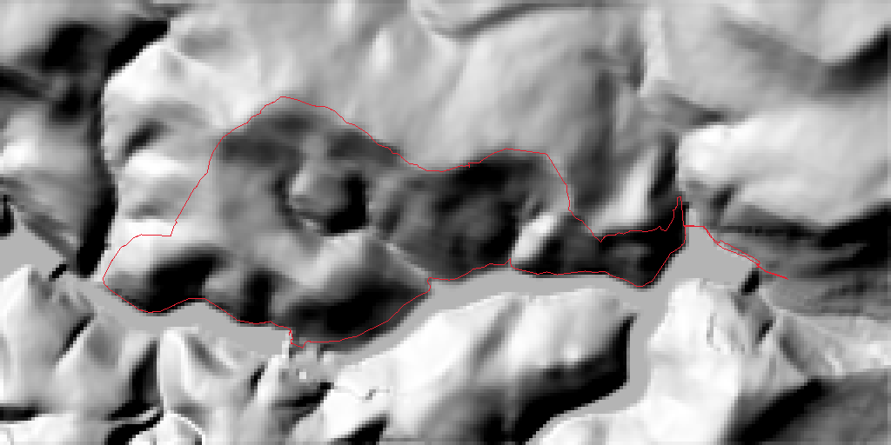
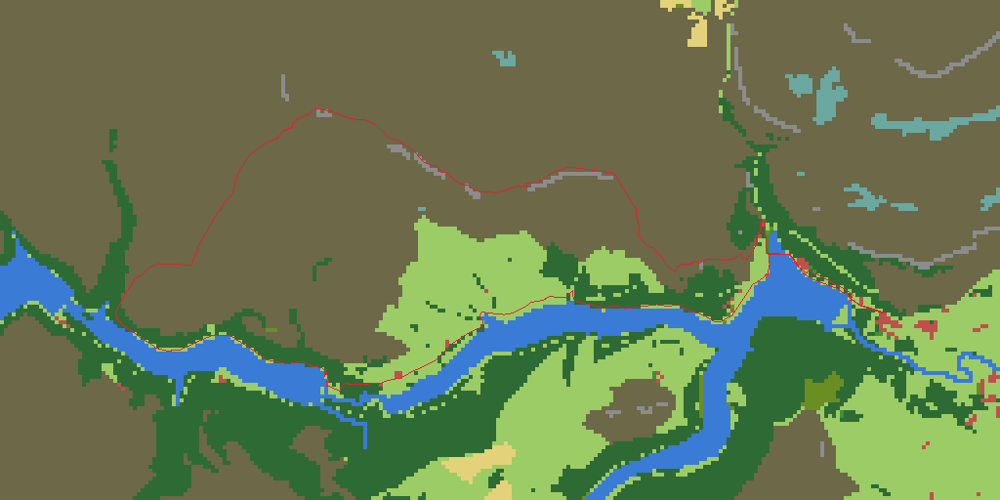
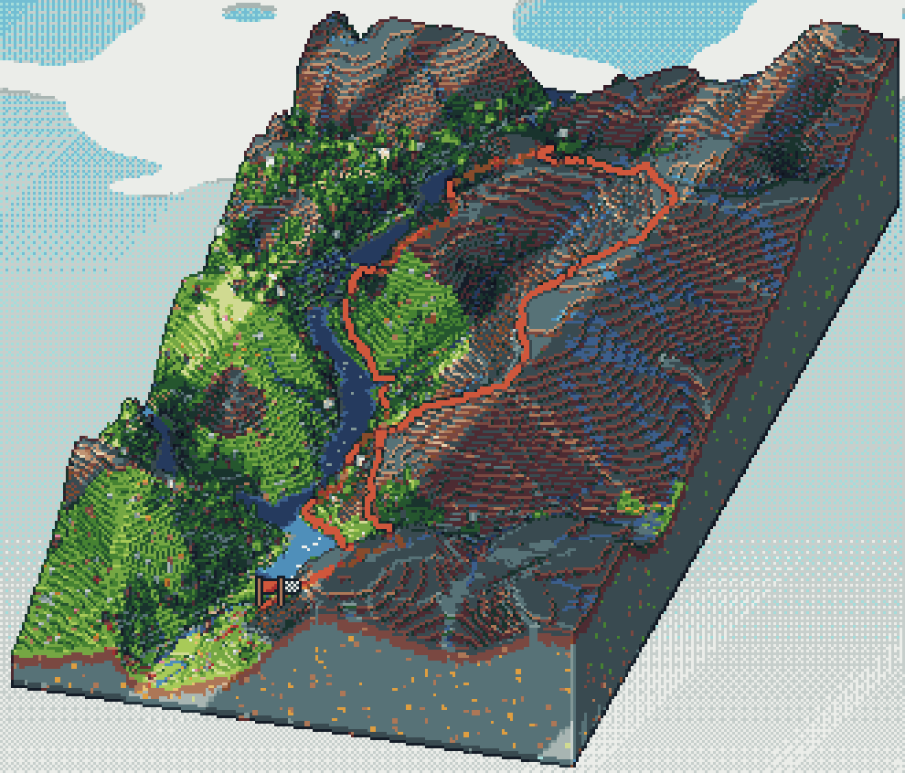
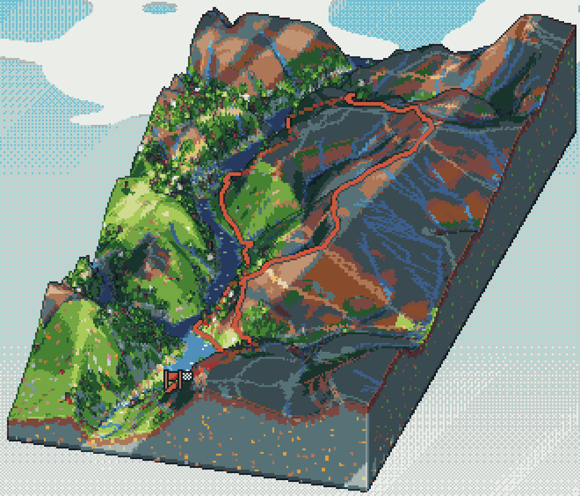
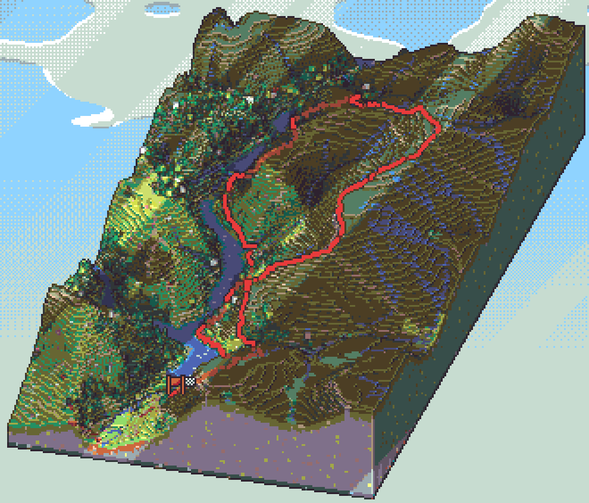
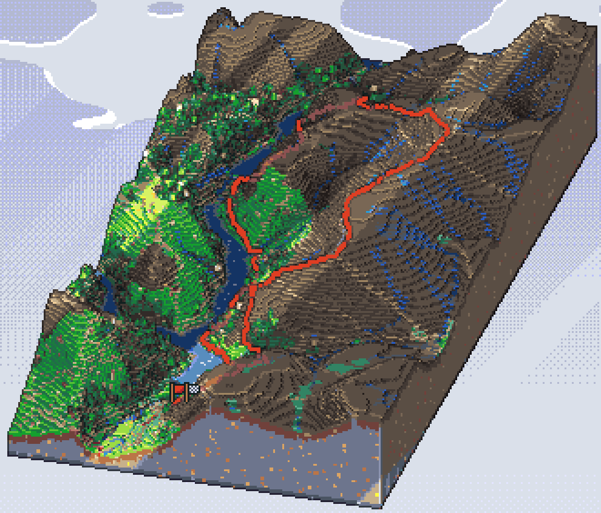

# How it works

isotrail turns a hike into an image in two stages. First it **prepares a scene**: it reads the GPX file, downloads the terrain around it and works out what covers the ground. Then it **renders** that scene on the GPU as low-resolution pixel art and enlarges it.

`isotrail render hike.gpx` runs both stages. `isotrail bundle` stops after the first and saves the scene, and `isotrail render hike.itb` starts from a saved scene.

## Preparing the scene

isotrail gathers everything a render needs and saves it together as a scene bundle. This is a compact, versioned binary file of ~100KB.

### The track

isotrail reads every track point and drops segments too short to draw. It works out the distance, the elevation gain and loss, and the moving and elapsed time. Gain and loss are smoothed, so GPS noise doesn't inflate the climb. The local time zone of the start sets the date.

### The slab

The diorama is a rectangle of terrain around the route. It is turned to line up with the direction the route mostly runs in, so diagonal routes don't waste space. It is padded by 15% on each side, at least 500m, and widened so it is never more than twice as long as it is wide.

The slab is divided into a grid of about 256 cells along its long side (`--detail`). A cell is ~25m across for a day hike, and a few hundred metres for a multi-day trek.

### Elevation

Heights come from the open [Terrain Tiles](https://registry.opendata.aws/terrain-tiles/) dataset. isotrail picks the zoom level whose resolution matches the grid and samples each cell from it. The heights are then exaggerated so the relief reads at diorama scale. Gentle moors get up to 5x and steep mountains less, and `--exaggeration` overrides it.

### Landcover

One [Overpass](https://overpass-api.de/) query fetches OpenStreetMap's forests, moorland, rock, scree, grass, farmland, wetlands, water, paths, roads, streams and coastlines for the slab. These are drawn onto the grid. Cells the map leaves empty are classified from the terrain: steep slopes become bare rock, and high ground becomes grass or rock. Lakes and reservoirs are flattened to a single water level.

OpenStreetMap draws coastlines with the land on their left, so the cells on their right are the sea. The sea lies flat at 0m, whatever the depth of the sea bed. The first cells of land beside it are raised to at least 0m, so the shore never dips under the water. The sea is drawn a darker blue than lakes, with a broken line of foam against the land and flecks of surf a little further out.

A slab with no coastline near it is all sea only when none of it is above sea level and the map shows nothing on land there. Ground below sea level inland stays land. With `--no-map-data` there is no query, and every cell is classified from the terrain. A slab that crosses the 180° meridian is queried as two boxes, one on each side.

  
  

### The route, sun and moon

The route is then draped onto the terrain. The sun's position over the slab is worked out every five minutes from the start of the hike to its end. isotrail uses the [NOAA solar calculator](https://gml.noaa.gov/grad/solcalc/) equations, which follow Jean Meeus's *Astronomical Algorithms*. The moon's position and phase come from the main terms of Meeus's lunar theory, good to a few tenths of a degree.

### Weather

The hourly weather during the hike comes from [Open-Meteo](https://open-meteo.com/). It holds the temperature, the WMO weather code, cloud cover at low, middle and high levels, rain, snowfall, snow depth and wind. It runs from the hour before the start to the hour after the end.

Hikes that ended at least five days ago use the historical archive (ERA5 reanalysis and related models). More recent ones, or any the archive hasn't filled in yet, use the forecast models' own past hours.

The weather is read in the middle of the route at the track's mean height, so the temperature is for the height walked. Long routes are split into stretches of about 20km, at most eight, and each hour reads the weather on the stretch the hiker was on. Between hours, values are interpolated. Rain, snow and the weather code hold through the hour they were measured over.

### Season

The date of the hike sets how far the plants have come through the year. South of the equator it is counted half a year on, and in the tropics not at all.

Snow comes from the weather. Where there was snow on the ground at the height walked, the snowline sits a little below the lowest snowy reading. It is lower for deep snow, and never below snow-free ground the route crossed. Where none lay but snow fell in the fortnight before or during the hike, the snowline sits 300m above that fortnight's average freezing level.

For ice, isotrail also fetches the daily lows and highs of the 14 days before the hike and adds up the frost. Each day's mean temperature is carried up or down at 6.5°C per kilometre. Lakes freeze from the height where the frost below zero adds up to 30 degree-days. The sea never freezes.

On the terrain, each broadleaf tree draws its own days for coming into leaf, turning and dropping its leaves. They come two days later in spring, and earlier in autumn, for every 100m above the slab's lowest ground. Grass, fields, moorland and wetland are blended towards their season's colour by a share that varies a little from cell to cell. A few meadow cells flower in spring.

Cells above the snowline are white unless they are steeper than 50°. Below it, each cell has its own reach, up to 150m and mostly short, so the snow breaks up into patches. Trees standing in snow are frosted. Frozen lakes are ice with a few cracks, or snow when they lie above the snowline.

## Rendering

The scene is drawn with [wgpu](https://wgpu.rs/) at a small internal resolution: 360 x 640 for a story at the default `--scale 3`. It takes eight steps.

1. The `voxel` mesher builds a column of blocks per cell, with heights rounded to whole blocks. The `smooth` mesher builds a low-poly surface instead, with one flat colour per triangle. Trees and boulders are placed from a seed taken from the scene, so the same hike always renders the same way.
2. The slab's cut faces show strata that follow the surface: a darker topsoil, a few blocks of dirt, then stone. Deep stone lines the base, with seeded pebbles and ore. Where a lake or the sea reaches the edge, its water shows in cross-section, under a block of ice when a lake is frozen. Under snow, the topsoil is a layer of snow.
3. The sun lights the scene and casts shadows from a shadow map. The light is cel-shaded into a few flat bands, and a soft fill from the viewer's side keeps faces that point away from the sun readable. The [next section](#light-weather-and-the-sky) describes the light in full.
4. Dark outlines mark the slab's silhouette and the places where one surface passes in front of another. Sharp outward folds, such as ridges and the rim of the slab, are picked out in a lighter shade.
5. The route is drawn as a bold line with a dark border that climbs every block step it crosses. Where a ridge hides it, it shows through as a faint dashed line. Flags mark the start and finish.
6. Every pixel is snapped to the nearest colour of the palette. Colours are compared in [OKLab](https://bottosson.github.io/posts/oklab/), a colour space that matches how alike colours look to the eye. The sky gradient is dithered with a fine checker pattern.
7. The title, date, stats and elevation profile are drawn in the [monogram](https://datagoblin.itch.io/monogram) pixel font. They sit on frosted panels that blur and tint the scene behind them, clear of the parts that social apps cover with their own buttons and captions.
8. The frame is enlarged by a whole number without smoothing, so every drawn pixel becomes a crisp square.

## Light, weather and the sky

The light, the weather and the sky are all set by one moment: the start of the hike, `--time`, or the time at the route's head in an animation.

### Sun and moon

The sun stands where it was at that moment. Its height sets the mood: white daylight above 20°, warmer and dimmer golden light as it sinks, orange at sunset, then the cool blue of dusk and night. The sky's gradient follows along. The light never comes from lower than 10°, so shadows stay long but bounded, and the scene still reads by night.

After dusk the moon takes over. The stronger its light, as from a full moon high in the sky, the more of the direct light and shadows come from it, in a cool blue-white. Tracks without times get a late-morning sun from the south-south-east.

### Depth

Each grid cell looks out in eight directions for the highest terrain within a few dozen cells. The higher its horizons, the less of the sky's light it gets, in the same bands as the sun's. Step walls take their share from the cell in front of them, so they darken at their feet, while the slab's cut faces look out into open air. Shadow edges are softened, and the bands turn the softening into a few steps.

### Clouds, rain and fog

Low and middle cloud dims the sun and greys the sky's colours, while thin high cloud barely does. Cloud also hides the stars and the moon.

Clouds are drawn in the sky from smooth noise, thresholded by the cloud cover, with a lit top and a shaded underside. They drift with the wind across the view. On a partly cloudy day, the same kind of noise over the ground takes the sunlight away under passing clouds, block by block.

Rain and snow are drawn over the finished scene in two layers, near and far, slanted by the wind blowing across the view. Each particle falls through a grid of cells, so the same moment always looks the same. Fog codes, heavy rain and low cloud fade the terrain towards a haze colour, more at the back of the slab than at the front.

### God rays

When the sun breaks through a partly cloudy sky, its light falls in beams, with gaps of shade between them that drift with the wind. Ground in a beam gets about twice the sunlight and ground in a gap about half, snapped to whole cells. The shafts themselves are only drawn against the sky, lined up with the ground they light. They are strongest from a low sun, and don't show under an overcast sky or at night.

### The sky

The sky behind the diorama is a band of the real sky, half a turn either side of the view across the frame's width. The horizon sits a little above the middle and the zenith at the top. The moon is drawn there as a disc, sunlit on the side facing the sun.

Stars fade in once the sun is 6° below the horizon. They are scattered from the bundle's seed, so every render of a hike shows the same sky, and they move with the camera as it turns.

## Animation

An animation renders the same scene once per frame. The mesh, trees and route are built once. The camera keeps one scale for the whole clip, wide enough to fit the slab from every angle of its turn, so the diorama never grows or shrinks. Its position is rounded to whole pixels, so the terrain doesn't shimmer as it moves.

Each frame draws the route up to a point: by distance, or by the recorded time with long stops cut short (`--pace time`). Stops of 6 hours or more are nights instead. The head waits for a set share of the drawing while the clock runs through the gap.

The same point fills the profile and sets the stats, which count up from what the hike had covered so far. The time there sets the sun, moon and weather. Rain, snow and clouds move with the clip's own clock, so they keep moving through the opening and the hold.

The finished frames are written to the GIF one by one, each keeping only the area that changed since the frame before. Frames that look the same as the one before are merged into one longer frame. For an MP4, each frame is enlarged to the full output size and piped to ffmpeg, which encodes it as H.264.

## In the browser

The same renderer compiles to WebAssembly and draws into a web page's canvas. It uses WebGPU where the browser has it, and WebGL2 otherwise. It loads a scene bundle, builds the mesh once, and redraws when the route's progress or the viewing angle changes. While rain or snow is falling, it redraws all the time.

Its pixels are as large as keep the frame's long side within 640 pixels, matching a still at `--scale 3`. One scale fits the slab from every angle, so the diorama can be turned all the way round. [`web/README.md`](../web/README.md) describes how to build it.

## Styles

The meshers and palettes can be mixed freely. `isotrail style-lab` renders every combination for your hike on one contact sheet.

<table>
  <tr>
    <td width="25%"></td>
    <td width="25%"></td>
    <td width="25%"></td>
    <td width="25%"></td>
  </tr>
  <tr>
    <td align="center"><code>voxel</code> · <code>apollo</code> (default)</td>
    <td align="center"><code>smooth</code> · <code>apollo</code></td>
    <td align="center"><code>voxel</code> · <code>resurrect-64</code></td>
    <td align="center"><code>voxel</code> · <code>aap-64</code></td>
  </tr>
</table>

## Data sources and fair use

isotrail downloads its data from three free services that others run for everyone to share. It only contacts them while it prepares a scene from a GPX file, in `render`, `bundle` and `embed`, and for `stats --weather`. A scene bundle renders without the network.

| Data | Service | Requests for one hike |
| --- | --- | --- |
| Elevation | [Terrain Tiles](https://registry.opendata.aws/terrain-tiles/) on AWS Open Data (`s3.amazonaws.com/elevation-tiles-prod`) | The tiles that cover the slab, usually a handful |
| Map data | The public [Overpass API](https://overpass-api.de/) (`overpass-api.de`) | One query, or two across the 180° meridian |
| Weather | [Open-Meteo](https://open-meteo.com/) (`archive-api.open-meteo.com`, or `api.open-meteo.com` for recent hikes) | Two, each for up to eight places along the route |

The two weather requests ask for the hours of the hike and for the daily lows and highs of the fortnight before it. With an API key, they go to `customer-archive-api.open-meteo.com` and `customer-api.open-meteo.com` instead.

Every answer is kept in the [cache](usage.md#cache), and nothing in it expires. Rendering a hike again, in any look or shape, sends no requests, and neither does a bundle. `--offline` makes sure of it. Each request names isotrail and this repository in its `User-Agent`, so the services' operators can tell where it came from.

### Overpass

The public server is shared by everyone who works with OpenStreetMap data. Its [usage policy](https://dev.overpass-api.de/overpass-doc/en/preface/commons.html) asks each user to stay below about 10,000 queries and 1GB of downloads a day. Rendering your own hikes stays far below that. When the server is busy, isotrail waits as it asks (see [data options](usage.md#data)).

To render many hikes at once, such as a whole archive of recordings, use another public instance or [run your own](https://dev.overpass-api.de/overpass-doc/en/more_info/setup.html). Point isotrail at it with `--overpass-url` or `ISOTRAIL_OVERPASS_URL`. `--no-map-data` leaves Overpass out altogether.

### Open-Meteo

The free API is for [non-commercial use only](https://open-meteo.com/en/terms), with fewer than 10,000 calls a day. Renders for a business, a client or a site with ads or subscriptions are commercial use. For those, choose one of these:

- Set `ISOTRAIL_OPEN_METEO_KEY` to the API key of one of [Open-Meteo's paid plans](https://open-meteo.com/en/pricing).
- [Run your own Open-Meteo server](https://github.com/open-meteo/open-meteo) and point `--weather-url` at it.
- Leave the weather out with `--no-weather`.

### Terrain Tiles

The tiles are free on AWS Open Data. Their sources ask to be credited, which the "Terrain Tiles (AWS)" in the credit line does. The full list of sources is on [joerd's attribution page](https://github.com/tilezen/joerd/blob/master/docs/attribution.md).

### Credit

All three services ask to be credited. Every render and embed carries a small credit line by default. If you leave it off with `--no-attribution`, isotrail prints the text, so you can put it in your post's caption or next to the image on your page.
