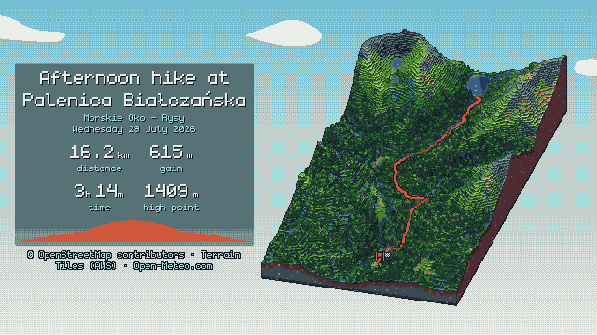
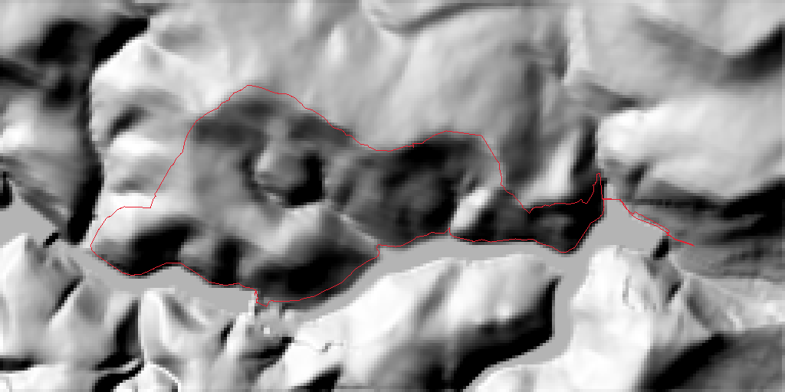
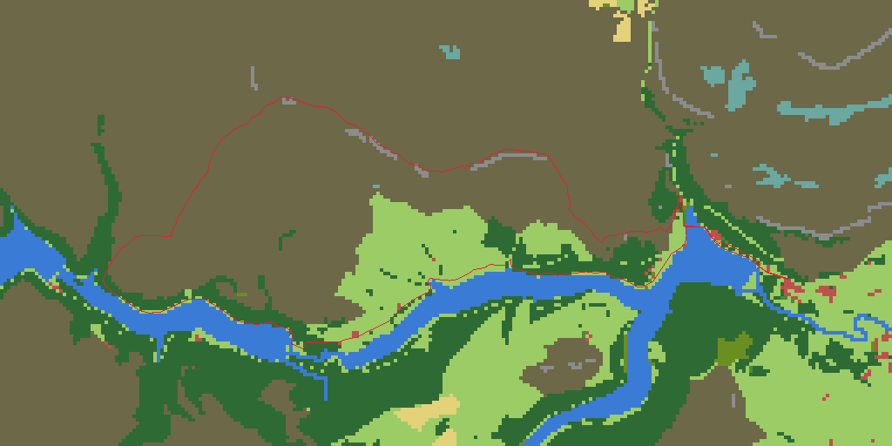

# Usage

isotrail has eight commands. `isotrail <command> --help` lists a command's options, grouped under the same headings as this page.

- [`render`](#render): render a hike as a PNG, an animated GIF or an MP4 video
- [`bundle`](#bundle): save a hike's scene as a `.itb` file
- [`embed`](#embed): put an interactive diorama of a hike on a web page
- [`batch`](#batch): make scene files, images and statistics for a folder of hikes
- [`stats`](#stats): print a hike's statistics
- [`style-lab`](#style-lab): compare every look on one contact sheet
- [`cache`](#cache): manage downloaded data
- [`theme`](#theme): write the built-in theme, to start your own from

Every command takes `-v` (`--verbose`) to show more log output, up to `-vvv`, and `-q` (`--quiet`) to show only errors. The end of the page covers [what a scene file contains](#what-a-scene-file-contains) and [output for scripts](#output-for-scripts). It also covers [how files are written](#writing-files), [exit codes](#exit-codes) and [which command takes which option](#which-command-takes-what).

## GPX files

isotrail reads GPX 1.0 and 1.1 files with tracks (`<trk>`) or routes (`<rte>`). They can be saved as UTF-8, or as UTF-16 with a byte-order mark.

- Every pause in a recording starts a new track segment. Where two segments are more than 50m apart, the route shows a gap instead of a straight jump.
- Several tracks in one file are joined into one hike, with a note.
- Files without timestamps still render, but without time-based stats.
- Files without elevations take their heights from the terrain.

A recording with a few bad points still renders. isotrail repairs it and warns once for each kind of repair:

- A point without a valid latitude and longitude is skipped. An elevation or time that can't be read counts as missing.
- A time before 1990 is ignored, and so is one weeks away from the points around it and from the rest of the hike.
- A stray point far from both its neighbours is dropped when the neighbours lie close together. Far means faster than 100m/s to reach, or a jump 50 times the usual step for points without times.
- When the times run backwards, the hike starts at its earliest time and ends at its latest. Animations keep their clock from going back.

Hikes that span more than 31 days get no sun, moon or weather.

## render

```text
isotrail render <hike.gpx | hike.itb> [options]
```

`render` makes a PNG, or an animation when the output name ends in `.gif` or `.mp4`. A GPX file is first prepared as [`bundle`](#bundle) does it, with the same data options. A scene bundle renders as it is, without the network.

Without `-o`, the picture is a PNG named after the input, in the current folder. With several aspects, each file gets the aspect added to its name: `-o hike.png --aspect story,wide` writes `hike-story.png` and `hike-wide.png`. Several sizes work the same way, so `--size 640x480,320x240` writes `hike-640x480.png` and `hike-320x240.png`.

### Image

| Option | Default | Description |
| --- | --- | --- |
| `-o, --output FILE` | `<input>.png` | The file to write: `.png` for a still, `.gif` or `.mp4` for an [animation](#animation) |
| `--aspect LIST` | `story` | Image shapes from the table below, separated by commas |
| `--size LIST` | none | Sizes instead of aspects, such as `1200x900,600x450`, each side from 16 to 8192 |
| `--safe-area T,R,B,L` | the shape's | Margins kept clear, in percent, each from 0 to 45 |
| `--scale N` | `3` | Output pixels per drawn pixel, from 1 to 16, dividing both sides of the image |
| `--background VALUE` | `sky` | `sky`, `transparent`, or a colour such as `#1e2a33` |

| Shape | Size | Kept clear |
| --- | --- | --- |
| `story` | 1080 x 1920 | 14% at the top, 20% at the bottom, 5% at the sides |
| `video` | 1080 x 1920 | 14% at the top, 35% at the bottom, 6% at the sides |
| `portrait` | 1080 x 1440 | 5% on every side |
| `feed` | 1080 x 1350 | 5% on every side |
| `square` | 1080 x 1080 | 5% on every side |
| `wide` | 1920 x 1080 | 5% on every side |

The diorama and text stay inside the shape's safe area. Stories keep the top and bottom clear because social apps cover them with their own header and reply bar. `video` keeps more room at the bottom and sides, where short-video feeds lay a caption and a column of buttons. `--size` keeps 5% clear on every side. `--safe-area` replaces the margins of any shape: give four numbers (top, right, bottom, left) or one for all sides.

The scene is drawn at the output size divided by `--scale`, then enlarged without smoothing, so every pixel stays crisp. A story at the default scale is drawn at 360 x 640. Lower scales give finer detail and higher ones chunkier pixels. `2`, `3`, `5`, `6` and `10` divide every shape.

`--background transparent` leaves the space round the diorama empty, to place it over a photo. A colour such as `#1e2a33` matches a web page, and it keeps its exact value instead of being snapped to the palette.

<p align="center"></p>

Images wider than they are tall put the title, stats and profile in one column on the left. The others put the title at the top and the stats at the bottom. [`--layout`](#text-and-overlays) picks either for any shape. An MP4 needs an even number of pixels on each side, which isotrail checks before it starts.

### Camera

| Option | Default | Description |
| --- | --- | --- |
| `--pitch DEG` | `30` | How far the camera looks down, from 10 (almost level) to 80 (almost straight down) |
| `--turn DEG` | `0` | Turns the camera anticlockwise round the slab, seen from above, from -360 to 360 |
| `--heading DEG` | along the hike | The compass bearing the camera looks towards, from 0 to 360 |
| `--zoom X` | `1` | The diorama's size, from 0.5 to 2 times what fits the safe area |

By default the camera looks along the direction of the hike. It is turned a little, so the trail runs up and to the right with its start in front. For loops and out-and-backs, it looks towards the halfway point.

`--turn` is added to the default view or to `--heading`. Above a `--zoom` of 1, the diorama's edges are cut off.

While an animation's camera turns, the diorama is drawn as large as fits at each angle. A long slab fits larger seen end-on than side-on, so the diorama grows and shrinks a little as it turns. Animations end on the still's view at the still's size, and their last frame matches it. The [live embed](#embed) turns the same way.

### Terrain and look

| Option | Default | Description |
| --- | --- | --- |
| `--mesher voxel\|smooth` | `voxel` | Stepped blocks, or a smooth low-poly surface |
| `--block-height F` | `1` | Height of a voxel block as a share of its width, from 0.25 to 4 |
| `--exaggeration X` | automatic | How many times taller than life to draw the terrain, from 0.1 to 100 |
| `--palette NAME\|FILE` | `apollo` | `apollo`, `resurrect-64`, `aap-64`, a [Lospec](https://lospec.com/palette-list) `.hex` file, or `none` |
| `--time HH:MM` | start of the hike | Light the scene as at this local time on the day of the hike |
| `--occlusion X` | `1` | How much hollows and valley floors darken, from 0 (none) to 1 |
| `--soft-shadows CELLS` | `1.5` | How wide shadow edges soften, in grid cells, from 0 (hard) to 4 |
| `--god-rays auto\|on\|off` | `auto` | Sunbeams through a partly cloudy sky, whenever the sun is up, or never |
| `--theme FILE` | none | Colours, words and fine-tuning from a [theme file](configuration.md#theme-files) |

`--block-height` only changes the voxel mesher. Low values give fine terraces and high values chunky steps. By default, the relief is scaled to about 15% of the slab's length, between 1x and 5x taller than life. The palette `none` keeps the colours as drawn, without snapping them to a palette.

`--time` needs a track with times. Try `--time 20:30` for an evening light. Options you type or set in a config file win over a theme.

The scene is lit by the sun as it stood when the hike started. It is high and white at midday, low and golden in the evening, and deep blue after dusk. The sky changes with it. After dusk the stars come out, and the moon shows where it stood, in its phase for the date. A bright moon lights the terrain. Tracks without times get a late-morning sun.

Hollows, valley floors and the feet of steps and cliffs see less of the sky, so they stay darker in the shade. Shadow edges soften into a few steps. When the sun breaks through a partly cloudy sky, it falls in beams. Shafts slant across the sky, and the ground they reach is lit brightly while the ground between them lies in shade. `--occlusion 0 --soft-shadows 0 --god-rays off` gives the plainer look of earlier versions.

Very tall or very detailed terrain can need more graphics memory than the GPU gives one model (256MB). A large `--exaggeration` with a small `--block-height` can do it, and so can `--detail 1024`. isotrail then stops before drawing anything. It says how much the terrain would need and which options to lower.

[How it works](how-it-works.md) explains what each part of the look does.

### Scene, light and route

These options switch parts of the scene on and off, change the light and style the route. In a [config file](configuration.md), `on` and `off` can also be written `true` and `false`.

| Option | Default | Description |
| --- | --- | --- |
| `--prop-density X` | `1` | Trees, bushes and boulders, from 0 (none) to 2 (twice as many) |
| `--paths on\|off` | `on` | Paths and roads from the map, drawn as lighter ground |
| `--streams on\|off` | `on` | Streams from the map |
| `--strata on\|off` | `on` | Soil and rock layers on the slab's cut faces |
| `--base-blocks N` | `6` | The slab's depth below the lowest ground, from 1 to 24 blocks |
| `--outlines X` | `1` | How strongly edges are outlined, from 0 (none) to 2 |
| `--shadows on\|off` | `on` | Shadows cast by the terrain and props |
| `--night-sky on\|off` | `on` | Stars and the moon after dusk |
| `--weather-effects LIST\|none` | `clouds,shade,rain,snow,haze` | Weather effects to draw: `clouds`, `shade`, `rain`, `snow`, `haze` |
| `--weather SKY` | the recorded weather | Draw `clear`, `cloudy`, `overcast`, `rain`, `snow` or `fog` instead |
| `--sun AZIMUTH,ELEVATION` | from the hike's time | Set the sun by hand: bearing from 0 to 360, elevation from -90 to 90 |
| `--route-colour #RRGGBB` | `#d64834` | The route's colour |
| `--route-width PX` | `2` | The route's width in drawn pixels, from 1 to 4 |
| `--route-hidden dashed\|dim\|solid\|off` | `dashed` | The route behind ridges: dashed, faded, solid or hidden |
| `--markers LIST\|none` | `start,finish,head` | Markers to draw: `start`, `finish` and the animation's `head` |

With `--paths off`, the ground under paths takes its own colour, and trees may grow there. `--streams off` keeps rivers and lakes. With `--strata off`, the cut faces are plain stone, still showing any lake or sea at the edge. With `--night-sky off`, moonlight still lights the terrain.

`shade` is the shade of passing clouds on the ground, and `haze` includes fog. Without `clouds`, the light under cloud is no longer dimmer and greyer, and `--god-rays auto` sees a clear sky.

`--weather` keeps the recorded wind, and the data credit stays as the bundle has it. `--sun 250,8` gives a low evening light from the west-south-west. It can't be typed with `--time`. Both `--weather` and `--sun` hold through a whole animation.

`--route-color` works too. Behind ridges, `dashed` also fades the route. The route's colour also fills the walked part of the profile and the web embed's progress line. Like every colour, it is snapped to the nearest one in the palette, so an unusual colour may come out a little different. A [theme](configuration.md#theme-files) can change the route's default colour and width.

`--weather-effects none --shadows off --outlines 0 --strata off --prop-density 0` gives a bare, schematic slab.

### Text and overlays

| Option | Default | Description |
| --- | --- | --- |
| `--overlay LIST\|none` | `title,date,stats,profile` | Parts to print over the diorama, or `none` for the diorama alone |
| `--panel frosted\|none` | `frosted` | Text on frosted panels, or straight on the scene with a dark outline |
| `--title TEXT` | the GPX name | Title to print instead of the hike's name |
| `--title-size large\|small` | `large` | The title large, or small like the date |
| `--subtitle TEXT\|none` | automatic | Line under the title, or `none` to never split a long title |
| `--date TEXT` | the hike's date | Text to print instead of the date |
| `--date-format long\|short\|iso` | `long` | `Saturday 14 June 2025`, `14 Jun 2025` or `2025-06-14` |
| `--stats LIST` | `distance,gain,time,high` | Stats to print, in this order, from the list below |
| `--units metric\|imperial` | `metric` | Kilometres and metres, or miles and feet |
| `--no-attribution` | off | Leave the data credit off the image, and print it for the caption |
| `--layout auto\|stacked\|column` | `auto` | Where the text goes: chosen by the image's shape, or one layout for all |
| `--credit-extra TEXT` | none | A line of your own under the data credit, such as your name or site |

The diorama grows into any space the overlays leave free. By default, a name too long for two lines is split at its first ` - ` or ` | ` into a title and a subtitle. `--subtitle none` keeps the name whole and shortens it with an ellipsis instead. The date is the local date where the hike started.

`--layout auto` puts the text in a column on the left of images wider than they are tall. `stacked` puts the title at the top and the stats at the bottom of any shape, and `column` puts everything in the left column. The line from `--credit-extra` goes with the credit when there is no room for it, and isn't printed for the caption.

The available stats are:

| Stat | Shows |
| --- | --- |
| `distance` | Total distance |
| `gain`, `loss` | Elevation gained and lost, smoothed to ignore GPS noise |
| `time` | Moving time, without pauses |
| `elapsed` | Time from start to finish, such as `3d 5h` for a multi-day trip |
| `high`, `low` | Highest and lowest point |
| `speed`, `pace` | Average speed or pace over the moving time |

A pause is a gap between points longer than a minute, or longer than three logging intervals for devices that log less often. Stats are laid out in as few rows as fit. A stat the recording can't give, such as moving time for a file without timestamps, is skipped with a warning.

The text is printed in a pixel font with Latin letters and their accents (Polish, Czech, German, French and so on). Characters it doesn't have, such as emoji, are left out with a warning.

On a small frame, such as a coarse `--scale` or a small `--size`, the overlays may not fit. They then give way one step at a time, only as far as needed, and a warning names each step:

1. A long date that doesn't fit its line is printed short (`14 Jun 2025`).
2. While the panels leave the diorama less than a sixth of the frame's height, the title is printed small. Then the subtitle goes, the stats move closer together and the profile is left out. Last, the data credit is left off and printed for the caption.
3. Finally, stats are left out from the end of the list, keeping at least one.

If even that doesn't fit, nothing is rendered and the command exits with code 2. Choose a lower `--scale`, fewer `--stats` or fewer `--overlay` parts. At the default `--scale 3`, every built-in shape has room for everything.

The data credit under the stats is required by the map and elevation data licences. When you hide it with `--no-attribution` or `--overlay none`, or there is no room for it, isotrail prints it instead:

```text
Credit for the caption: © OpenStreetMap contributors · Terrain Tiles (AWS)
```

When the weather is drawn, the credit on the image ends in "Open-Meteo.com", and the printed one in "Weather data by Open-Meteo.com".

### Weather

When the bundle holds the weather during the hike, the render shows it as it was at the start, or at `--time`:

- clouds in the sky and, on a partly cloudy day, their shade drifting over the ground
- a grey sky and duller light when it is overcast
- rain or snow, slanted by the wind
- haze in fog and heavy rain

Thin high cloud shows in the sky but doesn't dim the light. Animations follow the weather hour by hour as the route draws, and the rain, snow and clouds move from frame to frame.

`--no-weather` draws a clear sky instead. `--weather-effects` leaves out single effects, and `--weather` draws a sky of your choice (see [Scene, light and route](#scene-light-and-route)).

### Season

The landscape matches the time of year, across the whole slab:

- In spring, broadleaf woods and bushes come into pale fresh leaf, some in white or pink blossom first. Conifers show light new growth, meadows are dotted with wildflowers and fields are green with young crops.
- In summer, the landscape has the colours of the map.
- In autumn, broadleaf woods and bushes turn yellow, orange and rust, tree by tree, before they drop their leaves. Grass turns golden, moorland turns tan with dying bracken, and fields are ploughed brown.
- In winter, broadleaf trees stand bare over fallen leaves. Grass and fields are a dull winter brown, and moorland darkens.

Each cell takes a little more or less of its season's colour than the next, so the ground looks mottled rather than painted. Higher ground runs a little behind in spring and ahead in autumn. South of the equator the seasons are turned round, and in the tropics the trees keep their summer look.

When there was snow on the ground, the slopes above the snowline are white. Below it, snow lies in patches that thin out over 150m. Lakes that froze over in a cold spell are drawn as ice. [How it works](how-it-works.md#preparing-the-scene) explains how isotrail finds both. Snow and ice come with the weather, so `--no-weather` leaves them out too.

`--season spring`, `summer`, `autumn` or `winter` shows the hike in another season. A forced winter covers the whole slab in snow, except for cliffs, and freezes every lake. The sea stays open. Animations and the web embed keep one season throughout.

### Animation

A `.gif` or `.mp4` output is an animation in three parts. It opens on the scene with only the start flag. Then the route draws itself while the profile fills in and the stats count up. It ends on the finished hike.

| Part | Length | What it shows |
| --- | --- | --- |
| Intro | 5% of the clip, or `--intro` | The scene with only the start flag |
| Drawing | the time left over | The route drawing itself, with a marker at its head |
| Hold | 15% of the clip, or `--hold` | The finished hike |
| Rewind | 15% of the clip, taken from the drawing | The route undrawing, with `--loop-back` only |

The camera starts turned away by `--orbit` and eases round to the still's view by the time the route reaches the finish. The hold always shows, however short the clip or low its `--step-fps`. During the rewind, the stats count down and the camera turns back to where it began. A looping GIF or video then runs on without a jump.

The light follows the hike's clock. Each frame is lit by the sun and moon at the time the route's head was walked. The animation opens under the light of the start and ends under the light of the finish. With `--time`, one light holds through the whole animation.

A stop of 6 hours or more, such as a night on a multi-day trek, becomes a short pause. The head waits while the sun sets, the stars and moon cross the sky and the sun rises again. Each night takes 6% of the drawing time, and all of them together at most 30%.

| Option | Default | Description |
| --- | --- | --- |
| `--duration SECONDS` | `10s` | Length, such as `8s` or `2.5`, from 1s to 60s, or 180s for an MP4 |
| `--intro SECONDS` | 5% of the clip | Time on the scene before the route draws, from 0 to 180s |
| `--hold SECONDS` | 15% of the clip | Time on the finished hike, from 0 to 180s |
| `--loop-back` | off | Undraw the route and turn the camera back after the hold |
| `--fps N` | `30` | Frames per second, from 1 to 50 for a GIF and 60 for an MP4 |
| `--step-fps N` | off | Different images per second, from 1 to `--fps` |
| `--orbit DEG` | `30` | How far the camera turns, from -360 to 360 degrees |
| `--pace distance\|time` | `distance` | Draw the route at an even speed, or follow the recorded times |

The intro, hold and rewind must leave at least half a second to draw the route. A low `--step-fps` gives choppy, game-like motion. `--orbit 0` keeps the camera still, `360` makes a full turn, and a negative angle turns the other way.

With `--pace time`, slow climbs take longer than quick descents. Stops are cut to a minute, and nights become pauses as described above. Tracks without timestamps draw at an even speed.

GIFs use the render's palette, so `--palette none` can't be used with them. They can have a transparent background. By default they loop forever and are the same size as the PNG. They store only what changes from one frame to the next. A turning camera changes nearly every pixel, so a 10-second story is several megabytes. `--orbit 0` or `--gif-scale 1` makes it a fraction of that.

MP4s are H.264 videos without sound, for stories, posts and short videos. They are encoded at level 4.0 (4.2 above 30 frames a second) and tagged as BT.709 colour. They play as they are on older phones and in a web page's `<video>`. isotrail makes them with [ffmpeg](https://ffmpeg.org/download.html), which must be on your `PATH` unless you name it with `--ffmpeg`. Any palette works, including `none`. A video can't be transparent, so use `--background sky` or a colour.

The animation options only apply to `.gif` and `.mp4` output. PNG renders ignore them, so they can sit in a [config file](configuration.md) that you use for both.

### Encoding

| Option | Default | Description |
| --- | --- | --- |
| `--gif-scale N` | `--scale` | Output pixels per drawn pixel in a GIF, from 1 to `--scale` |
| `--loop forever\|once\|N` | `forever` | How many times a GIF plays: forever, once, or 1 to 1000 times |
| `--crf N` | `18` | MP4 quality, from 0 to 51: lower is better and larger |
| `--preset NAME` | `medium` | How hard the MP4 encoder works, from `ultrafast` to `veryslow` |
| `--ffmpeg PATH` | the `ffmpeg` on `PATH` | The ffmpeg program to make MP4s with |

`--gif-scale 1` writes the drawn size, 360 x 640 for a story, in about a quarter of the bytes. A web page can enlarge it with the CSS `image-rendering: pixelated`.

`--loop once` writes no loop at all. A number counts every play, so `--loop 3` plays three times. `--crf 0` is lossless, which many players can't play.

The presets are `ultrafast`, `superfast`, `veryfast`, `faster`, `fast`, `medium`, `slow`, `slower` and `veryslow`. Slower presets make smaller files at the same quality. `ISOTRAIL_FFMPEG` does the same as `--ffmpeg`.

The GIF options do nothing for an MP4, and the MP4 options nothing for a GIF. isotrail warns when you type one that the output doesn't use.

### Data

| Option | Default | Description |
| --- | --- | --- |
| `--detail N` | `256` | Grid cells along the slab's long side, from 8 to 1024 |
| `--offline` | off | Only use elevation, map and weather data already in the cache |
| `--overpass-url URL` | the public Overpass API | Another [Overpass](https://overpass-api.de/) server for the map data |
| `--terrain-url URL` | AWS Terrain Tiles | Elevation tiles from a mirror, as an address with `{z}`, `{x}` and `{y}` |
| `--weather-url URL` | Open-Meteo | Another server with [Open-Meteo](https://open-meteo.com/)'s API |
| `--cache-dir DIR` | see [cache](#cache) | The folder for downloaded data |
| `--no-map-data` | off | Build the diorama from the elevation alone, without lakes, woods and paths |
| `--padding P[,M]` | `15,500` | Ground round the route, from 0 to 100 percent and from 0 to 10000m |
| `--footprint route\|north` | `route` | Which way the slab's sides run: along the route, or north-south and east-west |
| `--no-weather` | off | Leave out the weather, with the snow and ice it brings |
| `--season SEASON` | `auto` | The [season](#season) to show: the hike's own, or `spring`, `summer`, `autumn` or `winter` |
| `--times recorded\|coarse\|none` | `recorded` | Times to keep in the scene: as recorded, rounded, or none |
| `--trim-start DIST` | `0` | Cut this far off the start of the route |
| `--trim-end DIST` | `0` | Cut this far off the end of the route |

The server and cache options can also be set in the environment: `ISOTRAIL_OVERPASS_URL`, `ISOTRAIL_TERRAIN_URL`, `ISOTRAIL_WEATHER_URL` and `ISOTRAIL_CACHE_DIR`. `--config FILE` reads settings from a TOML file (see [Configuration](configuration.md)).

`--padding` adds `P` percent of the route's length and width on each side, and at least `M` metres. `--weather-url` points at a server you host yourself, for example. isotrail adds `/v1/archive` and `/v1/forecast` to it. `--no-weather` also leaves out the weather a bundle holds. `--times` rounds the times or leaves them out, as [What a scene file contains](#what-a-scene-file-contains) explains.

`--trim-start` and `--trim-end` cut the ends off the route, for a walk that starts at your door. They take metres, such as `300`, or a distance with its unit, such as `300m` or `1.5km`. The same section explains what they change.

A scene bundle already holds its terrain and map data. `--detail`, `--offline`, `--overpass-url`, `--terrain-url`, `--weather-url`, `--cache-dir`, `--no-map-data`, `--padding` and `--footprint` do nothing with one, and isotrail warns when you type them for a bundle. `--times coarse`, `--times none`, `--trim-start` and `--trim-end` stop with an error instead, because a bundle keeps the times and route it was made with.

With an Open-Meteo API key in `ISOTRAIL_OPEN_METEO_KEY`, the weather comes from Open-Meteo's servers for customers, or from `--weather-url` with the key added. The key is only read from the environment, never from a flag or a config file. It is left out of the cache, the bundle and every message.

`--terrain-url` is meant for mirrors of the same elevation data, so the drawn credit still names Terrain Tiles. If your server has other data, credit it yourself, for example with `--credit-extra`. A key in the address (`key=`, `apikey=`, `token=` and the like) is masked in the bundle and in messages.

The public Overpass server is sometimes busy. isotrail then tries up to six times over about two minutes, with a line before each wait. If it still gets no map data, it stops and suggests three ways out:

- try again later
- use another server with `--overpass-url`
- use `--no-map-data`, which makes the diorama from the slope and height of the ground alone, with no lakes, woods, fields or paths and no OpenStreetMap credit

A server that can't be reached at all, such as a mistyped `--overpass-url`, is given up on after a few seconds. Any download that takes longer than 10 seconds prints a line saying it is still waiting.

Before its first download, a run prints one line saying what it fetches, such as `Downloading elevation, map and weather data for this area (kept in the cache for next time)`. A run that finds everything in the cache prints nothing, and neither does one with `-q` or `--json`.

## bundle

```text
isotrail bundle <hike.gpx> -o <hike.itb> [--debug-dir DIR] [--title TEXT] [--no-desc] [--exaggeration X] [--config FILE] [--json] [data options]
```

`bundle` downloads the elevation and OpenStreetMap data around the route and works out what covers each grid cell. It uses the map data where there is some, and the slope and height of the ground elsewhere. Lakes and reservoirs get a level surface, and the sea lies flat at sea level.

The result is a scene bundle: one compact file, usually under 100KB, that holds everything a render needs. It keeps the route, its elevation profile, the hike's statistics, the sun's and moon's paths and the weather hour by hour. Rendering it needs no further downloads.

Bundles are useful when you want to try many looks for one hike, render offline, or keep a hike's scene as it was after the map data changes. `bundle` reads GPX files only: give a bundle straight to `render`, `embed` or `stats`.

isotrail reads bundles in its own format and in the format before it. `embed` saves such a bundle in the current format.

When a release changes the format, the changelog says so. A bundle from before that has to be made again from the GPX file. One made by a newer version needs isotrail updated, and isotrail says which. A damaged bundle, or one holding values no render could draw, is refused with a message.

The command reports what it found:

```text
Heightmap 256 x 128 cells of 27.0m from 6 terrain tiles at zoom 13
Elevation 130 – 524m, drawn 2.4x taller
Map data: 1840 areas and 2210 lines from OpenStreetMap
Landcover: heath and moorland 52%, grassland 18%, broadleaf forest 11%, water 7%, ...
Water: 3 lakes levelled
Weather: partly cloudy, 11 – 16°C, 0.4mm rain (Open-Meteo archive)
Season: spring leaves
Route: 1650 points in 1 piece
Wrote hike.itb (92KB)
```

On a coast, the water line names the sea too (`Water: the sea and 2 lakes levelled`). `-v` also lists the map features by type. `--title TEXT` saves another title in the bundle instead of the GPX file's name, and renders and the web embed show it. `--no-desc` leaves the GPX file's description out of the bundle. [What a scene file contains](#what-a-scene-file-contains) lists what else it holds.

On long routes, where a grid cell is wider than 100m, footpaths, streams and minor roads are left out. They would be too small to show and would make the download much larger.

The weather comes from [Open-Meteo](https://open-meteo.com/), as [How it works](how-it-works.md#preparing-the-scene) explains. It needs the track's times, so tracks without them are bundled without weather. If the weather can't be fetched, for example offline with nothing in the cache, isotrail says why and makes the bundle without it. `--no-weather` skips it on purpose, and `isotrail stats --weather` shows what a bundle holds.

The season line names how the trees look. Where there is snow or ice, it also gives the heights above which the ground is white (`snow above 650m`) and the lakes are frozen (`lakes frozen above 400m`). `--season` saves another season in the bundle instead.

### Debug images

With `--debug-dir DIR`, `bundle` also writes images of the prepared terrain, to check it before rendering. Like the render, they are turned to follow the route, so they are not north-up.

| File | Shows |
| --- | --- |
| `heightmap.png` | Elevation, from the lowest ground (black) to the highest (white) |
| `hillshade.png` | Shaded relief, with the route in red |
| `landcover.png` | One colour per kind of ground, with the route in red |
| `landcover-legend.txt` | The landcover colours and how much of the slab each covers |
| `water.png` | Levelled lakes and the sea (white) and rivers (grey) |
| `paths.png` | Footpaths and tracks (white), roads (orange) and streams (blue) |

<p align="center">
  
  
</p>

## embed

```text
isotrail embed <hike.gpx | hike.itb> -o DIR [options]
```

`embed` writes everything a web page needs to show the hike as an interactive diorama with the [`<isotrail-hike>`](../web/README.md) element. A GPX file is first prepared as [`bundle`](#bundle) does it, with the same data options.

| File | What it is |
| --- | --- |
| `DIR/<name>.itb` | The scene bundle the element draws |
| `DIR/<name>.png` | The poster, the same image as `isotrail render --aspect <aspect>` with the same options |
| `DIR/snippet.html` | The two lines to paste into a page, also printed at the end |
| `DIR/<palette>.hex` | A copy of the palette file, with `--palette FILE` only |
| `DIR/<theme>.toml` | A copy of the theme file, with `--theme FILE` only |
| `DIR/isotrail-embed.js`, `DIR/pkg/` | The web runtime, with `--with-runtime` only |

`<name>` is the input's file name without its extension. The poster shows until the diorama is ready, and stays in browsers that can't draw it. The snippet names the theme copy in a `theme` attribute, so the live diorama is themed like the poster.

```html
<script type="module" src="/hikes/derwent/isotrail-embed.js?v=1.4.1"></script>
<isotrail-hike src="/hikes/derwent/derwent-edge.itb" poster="/hikes/derwent/derwent-edge.png" aspect="wide" style="display:block;aspect-ratio:16/9"></isotrail-hike>
```

The image inside the element shows the poster on pages where the script can't run. `?v=` carries the isotrail version, so browsers load the new runtime after an update instead of a cached old one. `--runtime-url` gets it too, unless that address already has a query.

Once the diorama is running, it shows the same data credit as the stills along its bottom edge. A page that hides it with the element's `credit="none"` must credit the data itself. `--no-attribution` prints the text to use.

| Option | Default | Description |
| --- | --- | --- |
| `-o`, `--output DIR` | required | The folder to write to, created if needed |
| `--aspect SHAPE` | `wide` | The shape of the element and its poster, from the [shapes](#image) |
| `--size WxH` | none | One size for the poster instead of an aspect, such as `1200x900` |
| `--safe-area T,R,B,L` | the shape's | The poster's margins, as for [`render`](#image) |
| `--scale N` | `3` | The poster's pixel scale, as for [`render`](#image) |
| `--with-runtime` | off | Also copy the web runtime into `DIR` |
| `--runtime-dir DIR` | the `web` folder next to `isotrail` | Where to copy the runtime from |
| `--base-url URL` | bare names | The address `DIR` will be served at, such as `/hikes/derwent/` |
| `--runtime-url URL` | `isotrail-embed.js` in `DIR` | The address of `isotrail-embed.js`, when one copy serves every hike |
| `--exaggeration X` | automatic | As for [`render`](#terrain-and-look) |
| `--no-desc` | off | Leave the GPX file's description out of the bundle |

With `--size`, the element takes the poster's shape, as in `aspect="4:3"` for `1200x900`. The live diorama picks its own pixel scale to suit the page.

The live diorama starts as large as the still. It shrinks only as far as each angle needs while it turns. A poster can then be its first frame, so the picture doesn't jump when the live view takes over. For that, the poster needs:

- no overlays, with `--overlay none`
- 5% margins, as `wide`, `square`, `feed`, `portrait` and `--size` have
- the size the element draws at

The element draws one pixel for each device pixel while its longer side is at most 640. A 640 x 360 element matches `--size 640x360 --scale 1`. A larger element draws coarser pixels: one of 1920 x 1080 draws at 640 x 360, like `--aspect wide` at the default `--scale 3`.

A runtime folder holds `isotrail-embed.js` and `pkg/`. Without `--base-url`, the snippet uses bare file names, relative to the page.

`embed` also takes `render`'s [terrain and look](#terrain-and-look), [scene, light and route](#scene-light-and-route), [camera](#camera), [text and overlay](#text-and-overlays) and [data](#data) options. It reads [config files](configuration.md) too. The poster is drawn with all of them.

The look, scene, light and route options reach the live diorama as well. Each one that isn't the default becomes an attribute of the element in the snippet. `--palette resurrect-64 --mesher smooth` gives:

```html
<isotrail-hike src="derwent-edge.itb" poster="derwent-edge.png" aspect="wide" palette="resurrect-64" mesher="smooth" …>
```

- The camera options become the `turn`, `pitch` and `zoom` attributes. They set the view the diorama starts from and returns to on reset. A `--heading` is written as the `turn` that faces the same way.
- With `--zoom` above 1, the diorama starts zoomed in. Below 1, it leaves more room round the slab.
- A palette file is copied into `DIR`, and the `palette` attribute points at the copy.
- With `--time` or `--sun`, the diorama keeps that light while the route plays, as an animation does.
- `--credit-extra` becomes the `credit-extra` attribute, and the live diorama shows the line under its data credit.
- `--title` is saved in the bundle, so the live diorama is labelled with it as well as the poster.
- `--layout` only shapes the poster.

### Playback and controls

These options set how the live diorama plays and what it shows. Each one that isn't the default becomes an attribute of the element. The poster doesn't change.

| Option | Default | Description |
| --- | --- | --- |
| `--duration SECONDS` | `10s` | Length of one play, from 1s to 180s |
| `--intro SECONDS` | 5% of a play | Time on the scene before the route draws, from 0 to 180s |
| `--hold SECONDS` | 15% of a play | Time on the finished hike before the next play, from 0 to 180s |
| `--loop-back` | off | Between plays, undraw the route and turn the camera back |
| `--rewind SECONDS` | `1s` | Time a press of play takes to undraw the finished route, from 0 to 10s |
| `--orbit DEG` | `30` | How far the camera turns while the route draws, from -360 to 360 degrees |
| `--pace distance\|time` | `distance` | Draw the route at an even speed, or follow the recorded times |
| `--loop forever\|once\|N` | `once` | How many times the diorama plays: forever, once, or 1 to 1000 times |
| `--autoplay` | off | Play as soon as the diorama shows, unless the visitor prefers reduced motion |
| `--load visible\|press` | `visible` | Load the diorama when it comes into view, or only when play is pressed |
| `--credit overlay\|below\|none` | `overlay` | Where the data credit goes: over the diorama, below it, or nowhere |
| `--controls LIST\|none` | all | The controls to show: `play`, `zoom`, `reset` and `scrubber`, or `none` |
| `--max-zoom X` | `3` | The largest zoom a visitor can reach, from 1 to 6 |
| `--lang CODE` | the page's | The language of the buttons, hints and messages: `en` or `pl` |
| `--strings FILE` | none | A JSON file of words to use instead of the built-in ones |

A play is split as an [animation](#animation) is. For every 10s, it spends 0.5s on the scene and 8s drawing the route. The 1.5s on the finished hike only shows between loops. `--orbit 0` keeps the camera still, and a negative angle turns the other way.

The diorama starts with the whole route drawn, like the poster. Pressing play first undraws the route over `--rewind` seconds, while the camera turns to where the play starts. The light stays as it was until the route draws again. `--rewind 0` empties the route at once. With reduced motion, the route undraws but the camera doesn't turn.

`--load press` suits a hike at the top of a page. The page loads only the script and the poster until a visitor presses play, as the [web guide](../web/README.md#loading-on-a-press) explains.

`--credit below` puts the data credit under the diorama as plain text in the page's colour. The snippet then gives its shape to the poster and adds the credit under it, so the line shows without the script too. Use `--credit none` only when the page credits the data itself, as the [web guide](../web/README.md#data-credit) explains.

The scrubber is the progress line along the bottom. With `--controls none`, visitors can still turn and zoom the diorama by hand and with the keys.

Without `--lang`, the element follows the page's own `lang`. A strings file looks like `{"play": "Start"}`, and the [words](../web/README.md#words) are listed with the element. The file's words are written into the snippet.

In a [config file](configuration.md), the `[render]` table's `duration`, `orbit`, `loop` and other playback keys reach `embed` too. An embed then plays like the animations, unless the `[embed]` table sets them.

When the input is a bundle that already sits in `DIR` under the name `embed` would give it, it is left as it is. `isotrail embed site/hike.itb -o site` only writes the poster and snippet. If `--title`, `--no-desc`, `--season`, `--no-weather` or `--exaggeration` would change the bundle, the command stops instead, so the bundle you started from is never replaced. Write to another folder then.

In Git Bash on Windows, an argument starting with `/` is turned into a Windows path before isotrail sees it. `--base-url /hikes/derwent/` becomes `C:/Program Files/Git/hikes/derwent/`, and isotrail warns when an address looks like that. Run the command as `MSYS_NO_PATHCONV=1 isotrail embed …`, or from PowerShell or Command Prompt.

The release downloads have the runtime in a `web` folder next to the `isotrail` program. If you built isotrail yourself, build the runtime with `sh web/build.sh` and pass `--runtime-dir web` from the repository. [`web/README.md`](../web/README.md) covers the element's attributes, Hugo and Astro examples, and how to share one runtime between hikes.

## batch

```text
isotrail batch <FOLDER> -o DIR [--force] [--profile N] [--json] [image options] [data options] [--no-desc] [--config FILE]
```

`batch` makes a scene file, an image and a JSON file for every GPX file in a folder. Run it again after you add or change a hike, and it only makes what changed. It suits a website built from a folder of hikes.

It reads each `.gpx` file directly in `FOLDER`, in order of name, and leaves out the folders inside it. For `ridge.gpx` it writes these files into `DIR`:

| File | Holds |
| --- | --- |
| `ridge.itb` | The scene file, as [`bundle`](#bundle) makes it |
| `ridge.png` | The image, as [`render`](#render) draws it |
| `ridge.json` | The hike's statistics and its files |

Several shapes or sizes give one image each, named as `render` names them: `ridge-story.png` and `ridge-wide.png`, for example.

`batch` takes `render`'s options for images, with the same defaults, so it draws one story image unless you ask for more. It takes `bundle`'s data options and `--no-desc` too. It doesn't make animations or embeds. [Which command takes what](#which-command-takes-what) lists its options.

| Option | Default | Description |
| --- | --- | --- |
| `-o`, `--output DIR` | required | The folder to write to, created if needed |
| `--force` | off | Make every hike again |
| `--profile N` | `64` | Points in each JSON file's elevation profile, from 2 to 256 |
| `--json` | off | Print one summary of the run, for scripts |

From config files, `batch` takes its own `[batch]` table, and the `[render]` settings that are also its options.

### Only what changed

Each JSON file records how its files were made: the GPX file's contents, the options and the isotrail version. The next run skips a hike when all three match and its files are still there. Otherwise it redoes as much as the change needs:

- A changed GPX file, data option or isotrail version makes everything again.
- A changed image option draws the images again from the scene file, with no downloads.
- A missing image is drawn again the same way.
- A changed `--profile` only writes the JSON file again.

`--offline`, `--cache-dir` and the server addresses don't count as changes. Neither does saving a GPX file without changing it. `--force` makes every hike again. Files a run no longer writes are left in place, such as the image of a shape you stopped asking for.

A hike that fails doesn't stop the rest. Its error is printed and the run goes on. At the end, `batch` exits with code 1.

Two GPX files whose names differ only by case, such as `Ridge.gpx` and `ridge.gpx`, both fail. They would write the same files on Windows and macOS, so rename one. Downloads run one hike at a time, and a busy server gets the usual retries.

Each hike gets a line, and the last line counts them:

```text
lakes.gpx (1 of 3): unchanged
moor.gpx (2 of 3): drawing the images again
Wrote site/moor.png
Wrote site/moor.json
ridge.gpx (3 of 3)
Wrote site/ridge.itb (64KB)
Wrote site/ridge.png
Wrote site/ridge.json
Hikes: 1 made, 1 redrawn, 1 unchanged
```

A second run with nothing new prints `Nothing to do: all 3 hikes are unchanged`.

### The JSON files

Each JSON file holds what `isotrail stats ridge.itb --json --weather --profile 64` prints. It adds the files written and what they were made from:

```json
"files": [
  { "path": "ridge.itb", "bytes": 65231 },
  { "path": "ridge.png", "bytes": 412877, "width": 1080, "height": 1920 }
],
"made_from": {
  "gpx": "ridge.gpx",
  "gpx_sha256": "9c1f…",
  "isotrail": "1.5.0",
  "scene_options": "41d2…",
  "image_options": "e07a…",
  "profile": 64
}
```

The paths are file names, so the folder can move to a website as it is. The options are kept as SHA-256 hashes, so no address or key you typed ends up in the file.

With `--json`, `batch` prints one summary of the run instead of its lines:

```json
{
  "hikes": [
    { "input": "hikes/ridge.gpx", "result": "made", "files": [ ... ] },
    {
      "input": "hikes/broken.gpx",
      "result": "failed",
      "files": [],
      "error": { "reason": "input", "message": "can't read hikes/broken.gpx: ..." }
    }
  ]
}
```

| Result | What the run did |
| --- | --- |
| `made` | Wrote every file |
| `redrawn` | Wrote the images and the JSON file |
| `rewritten` | Wrote the JSON file only |
| `unchanged` | Nothing |
| `failed` | Stopped with an error |

`files` lists the files written in this run, the JSON file included. An `error` has a [reason](#output-for-scripts) and a message, like a command's error object. A mistake that stops the whole run, such as a bad option, prints the usual error object instead.

## stats

```text
isotrail stats <hike.gpx | hike.itb> [--json [--profile N]] [--units metric|imperial] [--weather [--offline]] [--weather-url URL] [--cache-dir DIR]
```

`stats` prints a hike's distance, climb and times:

```text
Morning ridge walk

  Distance   12.40km
  Gain       620m
  Loss       618m
  Elevation  210 – 745m
  Elapsed    4h 10m
  Moving     3h 32m
  Start      2025-06-14 09:05 BST · 2025-06-14 08:05 UTC
  ...
```

The rest of the table gives the end time, the time zone, the bounding box, and the number of points and segments. Times are shown in local time and in UTC.

`--json` prints the same values as JSON for scripts. They are always in metres and seconds (`distance_m`, `gain_m`, `moving_s` and so on), whatever `--units` says.

`--profile N` adds the elevation profile to the JSON, as N points evenly spaced along the route. N goes from 2 to 256. Each point has its `distance_m` from the start and its `ele_m`:

```json
"profile": [
  { "distance_m": 0.0, "ele_m": 311.4 },
  { "distance_m": 196.8, "ele_m": 342.0 }
]
```

The points come from the bundle's profile, which is the one the image draws. A GPX file gives the same points from its own elevations. A GPX file without elevations gives no profile.

A bundle adds three keys that a GPX file doesn't have:

- `format`: the format the bundle was saved in, which can be the one before the current
- `generator`: the isotrail that made it, such as `isotrail 1.5.0`
- `caption_credit`: the data credit for the hike, as `render` prints it for a caption

`--weather` adds the weather during the hike. It comes from the bundle, or from [Open-Meteo](https://open-meteo.com/) for a GPX file, and `--offline` only uses the cache. A summary comes first, then one row per hour in local time. Temperatures and wind are values at the hour. Rain and snow are what fell in the hour before it.

```text
  Weather    light rain (Open-Meteo archive)
  Temp       11 – 14°C
  Rain       1.2mm
  Snowfall   none
  Wind       up to 32km/h WSW
  Credit     Weather data by Open-Meteo.com

  Hour       Temp  Conditions              Cloud l/m/h %    Precip  Wind
  Sat 14 Jun 2025
  09:00    11.2°C  overcast                     95/40/10         —  25km/h SW
  10:00    12.0°C  light rain                   90/60/20     0.8mm  29km/h WSW
  ...
```

With `--json`, the hourly samples are under `weather.samples`. Their keys include `temperature_c`, `cloud_cover_low_pct`, `precipitation_mm`, `snowfall_cm`, `snow_depth_m`, `wind_speed_m_s` and `wind_direction_deg`, which is where the wind blows from. Each also has the WMO `weather_code` and its `condition`.

The summary is under `weather.summary`, with the same values as the table:

```json
"summary": {
  "condition": "light rain",
  "weather_code": 61,
  "min_temperature_c": 11.2,
  "max_temperature_c": 14.0,
  "rain_mm": 1.2,
  "snowfall_cm": 0.0,
  "max_snow_depth_m": 0.0,
  "max_wind_speed_m_s": 8.9,
  "max_wind_direction_deg": 247.0
}
```

`max_wind_direction_deg` is where the strongest wind blew from.

## style-lab

```text
isotrail style-lab <hike.gpx | hike.itb> -o DIR [--aspect SHAPE] [--scale LIST] [--palette LIST] [--exaggeration X] [--theme FILE] [--config FILE] [--json] [data options]
```

`style-lab` renders the hike once for every mix of mesher (`voxel` and `smooth`), pixel scale and palette, as `DIR/<mesher>-<scale>-<palette>.png`. It also writes `DIR/contact-sheet.png`, which lays them all out side by side with a label above each. Compare them there before you choose your `render` options.

| Option | Default | Description |
| --- | --- | --- |
| `-o`, `--output DIR` | required | The folder to write to, created if needed |
| `--aspect SHAPE` | `story` | The shape of every image, from the [shapes](#image) |
| `--scale LIST` | `3,5,6` | The pixel scales to compare, each from 1 to 16 and dividing both sides |
| `--palette LIST` | every built-in palette | The palettes to compare: built-in names, `.hex` files or `none` |
| `--exaggeration X` | automatic | As for [`render`](#terrain-and-look) |
| `--theme FILE` | none | A [theme file](configuration.md#theme-files) for every image |

A palette file is labelled with its name without `.hex`. With a theme, you compare palettes and meshers in your own colours.

`style-lab` also takes the [data options](#data). From config files it takes its own `[style-lab]` table. From `[render]` it takes only the data settings, `exaggeration` and `theme`, so a palette or scale you render with doesn't narrow the comparison.

## cache

```text
isotrail cache path [--cache-dir DIR]
isotrail cache clear [--yes] [--older-than DAYS] [--cache-dir DIR]
```

Downloaded elevation tiles, map data and weather are kept in a cache on disk. Later renders of the same area are then fast and can work offline. Nothing expires on its own: map data stays as it was downloaded until you clear it.

`cache path` prints where the cache is. `cache clear` deletes it after asking, and `--yes` skips the question. `--older-than DAYS` only deletes downloads more than that many days old. `--older-than 90`, for example, picks up newer maps for areas you rendered long ago.

`cache clear` only deletes files that isotrail wrote. Anything else in the folder is left alone and counted in the message. A cached download that turns out to be damaged is dropped and fetched again.

| System | Cache folder |
| --- | --- |
| Windows | `%LOCALAPPDATA%\isotrail\cache` |
| Linux | `~/.cache/isotrail` |
| macOS | `~/Library/Caches/isotrail` |

Pass `--cache-dir DIR` to any command that downloads, or set `ISOTRAIL_CACHE_DIR`, to use another folder. The flag wins over the variable. `cache path` and `cache clear` also follow a `cache-dir` in the `[render]` table of your [user config file](configuration.md#config-files), below the flag and the variable.

## theme

```text
isotrail theme print [-o FILE]
```

`theme print` prints the built-in theme: every table and key of a [theme file](configuration.md#theme-files) at its built-in value, with comments on the tables and on the keys that need one. Save it, change what you like and delete the rest. Then pass it to `render`, `embed` or `style-lab` with `--theme`. Reading the printed file back changes nothing.

`-o FILE` writes it to a file instead. Use it in Windows PowerShell 5.1, whose `>` saves text as UTF-16. isotrail doesn't read UTF-16 as a theme.

## What a scene file contains

A scene bundle is often shared, for example beside an embed on a website. Anyone who downloads it can read what it holds:

- the title, and the name and description from the GPX file
- the date, the time zone, the hike's statistics and the area it covers
- the route as a line of points, each with its distance, elevation and time
- the slab's place on the map, its terrain and what covers the ground
- the sun and moon every 5 minutes from the start to the end
- the weather hour by hour, and the season

`isotrail stats hike.itb --json` prints most of it. These options keep a bundle from saying more than you want:

| Option | What it leaves out |
| --- | --- |
| `--times coarse` | The minute the hike started, and where you were when |
| `--times none` | The date and every time |
| `--no-desc` | The GPX file's description |
| `--trim-start`, `--trim-end` | Where the walk started and ended |

`--times` and the trim options work with a GPX file on `render`, `embed`, `bundle`, `batch` and `style-lab`. `--no-desc` works on `bundle`, `batch` and `embed`, and also on a bundle given to `embed`.

`--times coarse` rounds the start to the nearest half hour in local time. It rounds the length to the nearest quarter hour. Each point is then timed as if you walked at an even pace.

The sun, moon and weather follow these times. The date, the season and the moving and elapsed times stay as recorded. Animations of a hike over several days no longer pause for the nights.

`--times none` makes the bundle as if the GPX file had no times. It is lit by a late-morning sun, with no weather and no season of its own. isotrail says so in one line. `--time` needs the date, so it can't go with `--times none`.

The terrain and trees come out the same whichever `--times` you choose. Only the light can differ.

`--trim-start 300m` cuts the route at the first recorded point at least 300m from the start. `--trim-end` does the same from the end. Nothing about the cut part is kept.

The distance, climb, times, profile, weather and season all describe the part that is left. A trim that leaves none of the route stops with an error that gives the route's length. `isotrail stats hike.gpx` still describes the whole walk.

By default, the slab reaches at least 500m past the route. It may still show the ground you cut, without the route on it. A smaller `--padding` shows less ground round the route.

A bundle keeps the times and route it was made with. Given a bundle, `--times coarse`, `--times none` and the trim options stop with an error. A file that still holds what they leave out is never written. Make the bundle again from the GPX file.

None of this hides the area the hike was in. The slab, its map and the route show that.

## Output for scripts

`render`, `embed`, `bundle` and `style-lab` print a line for each file they write. With `--json` they print one JSON object at the end instead, and nothing else on standard output:

```json
{
  "files": [
    { "path": "hike.gif", "bytes": 4183920, "width": 1080, "height": 1920, "frames": 300 }
  ],
  "caption_credit": null
}
```

Each file has its `path` as written and its size in `bytes`. Images add `width` and `height`, and animations their number of `frames`. `stats --json` keeps [its own format](#stats), and `batch --json` prints [a summary of its run](#the-json-files).

`caption_credit` is the data credit to paste into a caption when the image doesn't show it, and `null` otherwise. The image leaves it out with `--no-attribution` or `--overlay none`, or when it doesn't fit.

`-q` (`--quiet`) prints only errors. Warnings and the lines about files written are left out, and so is the caption credit, which `--json` still reports. A command's own output still prints: the `stats` table, `cache path` and the JSON object.

When a command fails with `--json`, it prints an error object on standard output instead:

```json
{
  "error": {
    "reason": "offline",
    "message": "the elevation data for this area isn't in the cache yet; run once without --offline to download it"
  }
}
```

The `message` is the same as the error line on standard error, which still prints. The [exit code](#exit-codes) stays the same as without `--json`. This works for `render`, `embed`, `bundle`, `batch`, `style-lab` and `stats`.

| Reason | What went wrong |
| --- | --- |
| `usage` | A bad option or config file |
| `input` | The hike file is missing or isn't a hike |
| `version` | A scene file from an older or newer isotrail |
| `network` | A download failed |
| `offline` | Data missing from the cache |
| `ffmpeg` | ffmpeg is missing or failed |
| `gpu` | The graphics card couldn't draw |
| `interrupted` | Stopped with Ctrl+C |
| `other` | Anything else |

A `usage` error has exit code 2 and `interrupted` has 130. The others have 1. After a `version` error, make the scene file again from its GPX file, or update isotrail. An `other` error is often a file that couldn't be written.

## Writing files

Every command writes each file under a temporary name beside it, such as `hike.gif.4120.tmp`, and puts it in place once it is complete. A render that fails or is stopped with Ctrl+C leaves the previous file as it was and removes its temporary file. Existing files are overwritten without asking.

Before any download or render, isotrail checks where it will write:

- Missing folders are created.
- An output can't be one of the run's own inputs, however the path is spelt. `isotrail bundle walk.gpx -o walk.gpx` is refused, and so is a `--runtime-dir` that is the `embed` output folder.
- An output name can't be an existing folder, and an output folder can't be an existing file.

## Exit codes

| Code | Meaning |
| --- | --- |
| `0` | Success |
| `1` | The command failed while it ran |
| `2` | The command line or a config file asks for something isotrail can't do |
| `130` | Stopped with Ctrl+C |

Code 1 covers an input that is missing or isn't a GPX file or scene bundle. It also covers a file that couldn't be written, data that couldn't be downloaded and a failed render.

Code 2 covers mistakes that isotrail finds before any work:

- an unknown option or a bad value
- a palette, theme, config or strings file that is missing, can't be read or holds a mistake
- options that can't go together
- an output that would overwrite an input
- a trim that leaves none of the route

Nothing has been downloaded or written then. Overlays that don't fit the frame at all are only found once the hike is prepared. A GPX file's data may then have been downloaded and cached, but nothing is written.

With `--json`, a failure also prints [an error object](#output-for-scripts) that names its reason.

## Which command takes what

The commands that draw or prepare a hike share their options. This table shows which command takes which:

| Options | `render` | `embed` | `bundle` | `batch` | `style-lab` |
| --- | --- | --- | --- | --- | --- |
| [`--aspect`](#image) | several | one | – | several | one |
| [`--scale`](#image) | yes | for the poster | – | yes | several |
| [`--size`, `--safe-area`](#image) | yes | for the poster | – | yes | – |
| [`--pitch`, `--turn`, `--heading`, `--zoom`](#camera) | yes | yes | – | yes | – |
| [`--palette`](#terrain-and-look) | yes | yes | – | yes | several |
| [`--exaggeration`](#terrain-and-look) | yes | yes | yes | yes | yes |
| Other [look options](#terrain-and-look) | yes | yes | – | yes | – |
| [`--theme FILE`](configuration.md#theme-files) | yes | yes | – | yes | yes |
| [Scene, light and route](#scene-light-and-route) | yes | yes | – | yes | – |
| [Text and overlays](#text-and-overlays) | yes | for the poster | `--title` only | yes | – |
| [`--duration`, `--intro`, `--hold`, `--loop-back`](#animation) | yes | [for playback](#playback-and-controls) | – | – | – |
| [`--orbit`, `--pace`](#animation), [`--loop`](#encoding) | yes | [for playback](#playback-and-controls) | – | – | – |
| [`--fps`, `--step-fps`](#animation), other [encoding](#encoding) options | yes | – | – | – | – |
| [Data](#data) | yes | yes | yes | yes | yes |
| [`--no-desc`](#what-a-scene-file-contains) | – | yes | yes | yes | – |
| [`--config FILE`](configuration.md) | yes | yes | yes | yes | yes |
| [`--json`](#output-for-scripts) | yes | yes | yes | yes | yes |
