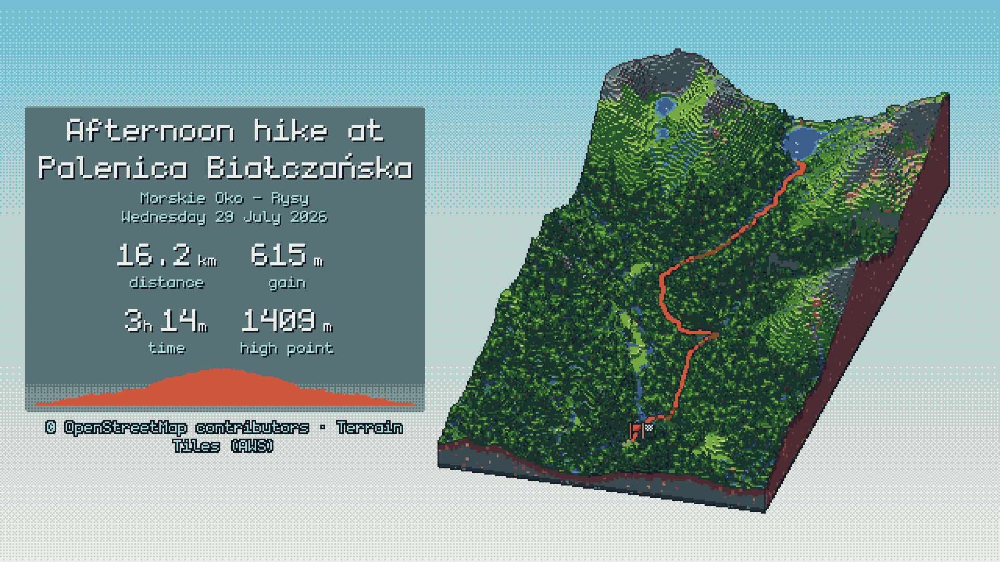

# Usage

isotrail has five commands. Each one prints its options with `--help`, for example `isotrail render --help`. The global flag `-v` (repeatable, up to `-vvv`) shows more log output.

- [`render`](#render): render a hike as a PNG
- [`bundle`](#bundle): save a hike's scene as a `.itb` file
- [`stats`](#stats): print a hike's statistics
- [`style-lab`](#style-lab): compare every look on one contact sheet
- [`cache`](#cache): manage downloaded data

isotrail reads GPX 1.0 and 1.1 files, with tracks (`<trk>`) or routes (`<rte>`). Every pause in a recording starts a new track segment. Where two segments are more than 50 m apart, the route is drawn with a gap instead of a straight jump. Files without timestamps still render, but without time-based stats. Files without elevations take their heights from the terrain.

## render

```text
isotrail render <hike.gpx | hike.itb> [options]
```

Renders the hike as a PNG. A GPX file is first prepared in the same way as [`bundle`](#bundle), with the same data options. A scene bundle is rendered as it is, without the network.

Without `-o`, the image is named after the input and written to the current directory. When you ask for several aspects, each file gets the aspect added to its name: `-o hike.png --aspect story,wide` writes `hike-story.png` and `hike-wide.png`.

### Image

| Option | Default | Description |
| --- | --- | --- |
| `-o, --output IMAGE` | `<input>.png` | Where to write the image. Only `.png` is supported so far |
| `--aspect LIST` | `story` | One or more of `story` (1080 x 1920), `feed` (1080 x 1350), `square` (1080 x 1080) and `wide` (1920 x 1080), separated by commas |
| `--scale N` | `3` | Output pixels per drawn pixel: `2`, `3`, `5`, `6` or `10`. Lower values give finer detail; higher values give chunkier pixels |
| `--background VALUE` | `sky` | `sky` for a dithered gradient, `transparent` to place the diorama over a photo, or an exact colour such as `#1e2a33` to match a web page |

The scene is drawn at the output size divided by `--scale` (360 x 640 for a story at the default scale), then enlarged without smoothing, so every pixel stays crisp.

<p align="center"></p>

Stories leave the top 14% and bottom 20% of the image free of text, because Instagram covers those parts with its own interface. In the `wide` format, the title, stats and profile share one column on the left, beside the diorama.

### Terrain and look

| Option | Default | Description |
| --- | --- | --- |
| `--mesher voxel\|smooth` | `voxel` | Stepped blocks, or a smooth low-poly surface |
| `--block-height F` | `1` | Voxel block height as a share of its width, from `0.25` (fine terraces) to `4` (chunky steps). Voxel mesher only |
| `--exaggeration X` | automatic | How many times taller than life the terrain is drawn, from `0.1` to `100`. By default, the relief is scaled to about 15% of the slab's length, between 1× and 5× |
| `--palette NAME\|FILE` | `apollo` | A built-in palette (`apollo`, `resurrect-64`, `aap-64`), any [Lospec](https://lospec.com/palette-list) `.hex` file, or `none` to keep the unquantised colours |

The slab is turned to follow the route, and the camera looks the way the hike goes, so the start is in front. For loops and out-and-backs, the camera looks towards the halfway point. See [How it works](how-it-works.md) for what each part of the look does.

### Text and overlays

| Option | Default | Description |
| --- | --- | --- |
| `--overlay LIST` | `title,date,stats,profile` | Which parts to print, or `none` for the diorama alone. The diorama grows into any space left free |
| `--panel frosted\|none` | `frosted` | Print the text on frosted panels, or straight on the scene with a dark outline |
| `--title TEXT` | GPX name | Title to print instead of the hike's name |
| `--title-size large\|small` | `large` | Print the title large, or at the size of the subtitle |
| `--subtitle TEXT\|none` | automatic | Line under the title. By default, a name too long for two lines is split at its first ` - ` or ` \| `. `none` never splits it and shortens a long title with an ellipsis instead |
| `--date TEXT` | hike's date | Text to print instead of the date |
| `--date-format long\|short\|iso` | `long` | `Saturday 14 June 2025`, `14 Jun 2025` or `2025-06-14`. The date is the local date where the hike started |
| `--stats LIST` | `distance,gain,time,high` | Stats to print, in order. See the list below |
| `--units metric\|imperial` | `metric` | Kilometres and metres, or miles and feet |
| `--no-attribution` | off | Leave the data credit off the image, and print it to paste into the caption |

The available stats are:

| Stat | Shows |
| --- | --- |
| `distance` | Total distance |
| `gain`, `loss` | Elevation gained and lost, smoothed to ignore GPS noise |
| `time` | Moving time, without pauses |
| `elapsed` | Time from start to finish, as `3d 5h` for multi-day trips |
| `high`, `low` | Highest and lowest point |
| `speed`, `pace` | Average speed or pace over the moving time |

Stats are laid out in as few rows as fit. Any stat the recording can't provide (moving time for a file without timestamps, for example) is skipped with a warning.

The data credit under the stats is required by the map and elevation data licences. When you hide it with `--no-attribution` or `--overlay none`, isotrail prints it instead:

```text
Credit for the caption: © OpenStreetMap contributors · Terrain Tiles (AWS)
```

### Data

| Option | Default | Description |
| --- | --- | --- |
| `--detail N` | `256` | Grid cells along the slab's long side, from `8` to `1024` |
| `--offline` | off | Only use data that is already in the cache |
| `--overpass-url URL` | public Overpass API | Another [Overpass](https://overpass-api.de/) endpoint for map data (also `ISOTRAIL_OVERPASS_URL`) |
| `--config FILE` | none | Read settings from a TOML file (see [Configuration](configuration.md)) |

## bundle

```text
isotrail bundle <hike.gpx> -o <hike.itb> [--debug-dir DIR] [--exaggeration X] [--detail N] [--offline] [--overpass-url URL]
```

Downloads the elevation and OpenStreetMap data around the route and works out what covers every grid cell: from the map data where there is some, and from the slope and height of the ground elsewhere. Lakes and reservoirs get a level surface. The result is saved with the route, its elevation profile and the hike's statistics as a **scene bundle**: one compact file (usually under 100 KB) that holds everything a render needs, with no further downloads.

Bundles are useful when you want to try many looks for one hike, to render offline, or to keep a hike's scene as it was even after the map data changes.

The command reports what it found:

```text
Heightmap 256 x 128 cells of 27.0 m from 6 terrain tiles at zoom 13
Elevation 130 – 524 m, drawn 2.4× taller
Map data: 1840 areas and 2210 lines from OpenStreetMap
Landcover: heath and moorland 52%, grassland 18%, broadleaf forest 11%, water 7%, ...
Water: 3 lakes levelled
Route: 1650 points in 1 piece
Wrote hike.itb (92 KB)
```

`-v` also lists the map features by type.

On long routes, where a grid cell is wider than 100 m, footpaths, streams and minor roads are left out, because they would be too small to show and would make the download much larger.

### Debug images

With `--debug-dir DIR`, `bundle` also writes images of the prepared terrain, to check it before rendering. Like the render, these are turned to follow the route, so they are not north-up.

| File | Shows |
| --- | --- |
| `heightmap.png` | Elevation, from the lowest ground (black) to the highest (white) |
| `hillshade.png` | Shaded relief, with the route in red |
| `landcover.png` | One colour per kind of ground, with the route in red |
| `landcover-legend.txt` | The landcover colours and how much of the slab each covers |
| `water.png` | Levelled lakes (white) and rivers (grey) |
| `paths.png` | Footpaths and tracks (white), roads (orange) and streams (blue) |

<p align="center">
  
  
</p>

## stats

```text
isotrail stats <hike.gpx | hike.itb> [--json] [--units metric|imperial]
```

Prints a hike's statistics: distance, elevation gain and loss, the elevation range, elapsed and moving time, start and end times in the local time zone and in UTC, the bounding box, and the number of points and segments.

```text
Morning ridge walk

  Distance   12.40 km
  Gain       620 m
  Loss       618 m
  Elevation  210 – 745 m
  Elapsed    4h 10m
  Moving     3h 32m
  Start      2025-06-14 09:05 BST · 2025-06-14 08:05 UTC
  ...
```

`--json` prints the same values as JSON for scripts, always in metres and seconds (`distance_m`, `gain_m`, `moving_s` and so on), whatever `--units` says.

## style-lab

```text
isotrail style-lab <hike.gpx | hike.itb> -o DIR [--detail N] [--offline] [--overpass-url URL]
```

Renders the hike once for every combination of mesher (`voxel`, `smooth`), pixel scale (3, 5, 6) and built-in palette, as `DIR/<mesher>-<scale>-<palette>.png`. It also writes `DIR/contact-sheet.png`, which lays them all out side by side with a label above each, so you can compare looks before choosing your `render` options.

## cache

```text
isotrail cache path
isotrail cache clear [--yes]
```

Downloaded elevation tiles and map data are cached on disk, so later renders of the same area are fast and can work offline. `cache path` prints where the cache is, and `cache clear` deletes it after asking (`--yes` skips the question).

| System | Cache directory |
| --- | --- |
| Windows | `%LOCALAPPDATA%\isotrail\cache` |
| Linux | `~/.cache/isotrail` |
| macOS | `~/Library/Caches/isotrail` |

Set `ISOTRAIL_CACHE_DIR` to use another directory.
